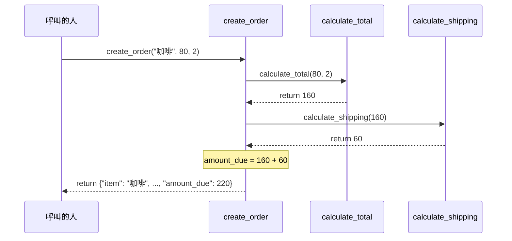

# 03 輔助材料：資料怎麼在函式之間傳

以「咖啡 80 元買 2 杯」為例。每個箭頭往右是「呼叫並把資料交過去」，虛線往左是「`return` 交回結果」。

讀圖重點：

- `create_order` 自己不算金額、也不判斷運費，它只負責「問人」再把答案組起來。
- `calculate_shipping` 需要的 160，是從 `calculate_total` 拿回來的。上一個函式的輸出，變成下一個函式的輸入。
