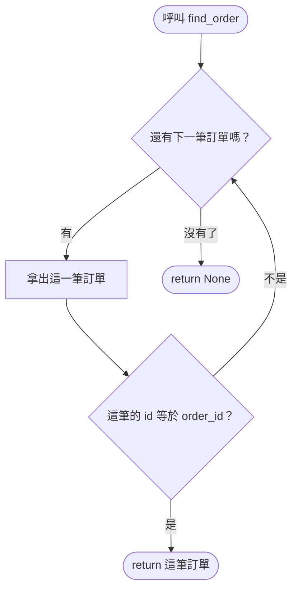

# 04 輔助材料：一筆一筆找的流程

以 `find_order(orders, 2)` 為例：先看第 1 筆（id 是 1，不是）→ 再看第 2 筆（id 是 2，是！）→ 立刻交回，第 3 筆不用看了。

讀圖重點：

- 「是」的那條路一走到 `return`，函式就**立刻結束**，後面的訂單不會再檢查。
- `return None` 只有在**全部都看完**還沒找到時才會走到。想想看：這行該放在迴圈裡面，還是迴圈外面？
- 傳進空的 list `[]` 時，第一次問「還有下一筆嗎？」答案就是「沒有了」，直接走到 `return None`。
