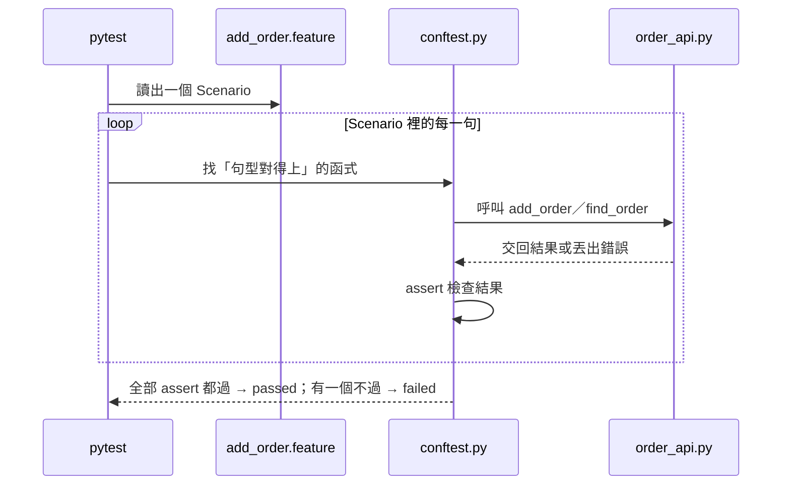

# 複習：訂單 API 第 1 階段（order_api）

這份整理 2026-10-31 這一整輪：從函式練習，到定契約、寫測試、實作、審邊界、親手修 bug、店員程式驗收。

跟上一份 [functions-01-05-syntax-review.md](functions-01-05-syntax-review.md) 一樣，目標是**看懂**，不用背。前半段講「做了什麼、為什麼」，後半段把專案裡新出現的語法逐行翻成白話。

---

## 全貌：這一輪走過的路

| # | 步驟 | 誰做 | 產出 |
|---|---|---|---|
| 1 | 函式練習 01–05 | 你 | 定義函式、回傳 dict、組合函式、查詢、新增 |
| 2 | `/spec` 定契約 | 你決定，Claude 提問 | [SPEC.md](../projects/order_api/SPEC.md)、[schema.dbml](../projects/order_api/schema.dbml)、兩個 `.feature` |
| 3 | 畫設計圖 | Claude 畫，你審 | SPEC 裡的循序圖、活動圖；順便挖出「檢查順序」沒定 |
| 4 | 寫測試 → red | Claude | [conftest.py](../projects/order_api/conftest.py)，15 個 Scenario 全部失敗 |
| 5 | 你審測試 → commit | 你 | 從這一刻起，測試就是驗收標準 |
| 6 | 寫實作 → green | Claude | [order_api.py](../projects/order_api/order_api.py) |
| 7 | `/edges` 審邊界 | Claude 報告，你決定 | 補 2 個 Scenario：數量 2.0、空白商品名稱 |
| 8 | 修空白名稱的 bug | **你** | 第 19 行改成 `item.strip() == ""` |
| 9 | 店員程式 | Claude 寫，**你親手驗收** | [clerk.py](../projects/order_api/clerk.py) |

---

## 三明治流程：這次實際長什麼樣

那位資深工程師說「人定契約、agent 實作、人審邊界」。這次三層各自是：

**頂層｜你定契約**

你沒寫一行程式，但決定了所有「什麼算對」：

| 你的決定 | 為什麼 | 鎖在哪個 Scenario |
|---|---|---|
| 新增時給 `item`、`quantity`、`price` | 有單價和數量才能算金額 | 未滿 500 元，收運費 |
| 包含運費，滿 500 免運 | 沿用練習 03 | 剛好 500 元，免運 |
| 單價 .5 一律進位 | 符合店員直覺（Python 內建 `round` 不是） | 單價剛好 .5，進位 |
| 單價、數量可以是 0 | 贈品、數量 0 都可能發生 | 單價是 0（贈品）、數量是 0 |
| 贈品也收運費 | 寄送贈品的運費由客人負擔合理 | 單價是 0（贈品），照規則收運費 |
| 負數失敗、數量有小數失敗 | 不合理的輸入 | 數量是負數、單價是負數、數量有小數 |
| 失敗時 `raise ValueError` 並附訊息 | Python 的標準做法，B 階段可對應 HTTP 400 | 所有「新增失敗」的 Scenario |
| 檢查順序：名稱 → 數量整數 → 數量負數 → 單價負數 | 兩個錯同時發生時，訊息要固定 | 同時違反兩條規則 |
| 2.0 視為整數 2 | 數學上就是整數 | 數量是 2.0 |
| 只有空白的名稱算空的 | 店員多按空白鍵很常見 | 商品名稱只有空白 |
| 找不到回傳 `None` | 沿用練習 04 | 編號不存在、一筆都沒有 |

**中層｜Claude 閉環**

先寫測試、確認全部 red，你看過後 commit，才寫實作到 green。實作期間測試一行都沒動，`/edges` 用 `git diff` 確認過。

**底層｜你審邊界**

`/edges` 列出測試沒涵蓋的情況，每一條都附上實際呼叫的結果。你從中挑了兩條補成 Scenario，其餘的（文字型別、`None`、精度誤差）留給 B 階段或不處理。

---

## 四個概念在這個專案裡

### 資料流

```
店員打字（文字）
  → clerk.py 轉成數字（不是數字就擋下）
  → add_order 檢查合不合法（不合法就 raise）
  → 整理：數量轉整數、單價四捨五入
  → 計算：total、shipping、amount_due
  → 給編號：len(orders) + 1
  → 落地：append 進 orders
  → 回傳訂單 dict
  → clerk.py 印給店員看
```

每一站只做一件事。SPEC 裡的循序圖畫的就是這條線。

### API 契約

契約不只是「欄位名稱」，這次你定下的契約包含：

- **給什麼**：`item`、`quantity`、`price`
- **拿回什麼**：8 個欄位的 dict
- **壞掉時拿回什麼**：`ValueError` 加上**逐字固定**的錯誤訊息
- **多個錯同時發生時，報哪一個**：檢查順序

最後兩項最容易被忽略，卻是呼叫的人最依賴的部分。

### 邊界條件

這次的邊界條件幾乎都落在「分界線上」：

| 分界線 | 線的這邊 | 線的那邊 |
|---|---|---|
| 運費 | 499 收 60 | 500 免運 |
| 四捨五入 | 80.4 → 80 | 80.5 → 81 |
| 數量、單價 | 0 合法 | -1 失敗 |
| 數量 | 2.0 合法 | 2.4 失敗 |
| 商品名稱 | `"咖啡"` 合法 | `""`、`"  "` 失敗 |

### 狀態機

第 1 階段刻意略過（新訂單一律「待付款」）。但 `/edges` 預告了第 3 階段的問題：`find_order` 交出去的是**同一張表單本身**，呼叫的人改了 `status`，存著的訂單也跟著變。之後要讓狀態「只能透過 API 改」，就得處理這件事。

---

## 測試怎麼守住契約：你親身遇到的兩個例子

修空白名稱時，你的第一版改了兩個地方，測試立刻抓到兩個問題：

**例 1：寫死特定值**

```python
if item == "  ":    # 只抓得到「剛好兩個空白」
```

「只有空白」那條變綠了，但原本綠的「商品名稱是空的」變紅，因為 `""` 不再被抓到。修 bug 時只對準眼前那個測試，很容易弄壞別的。

**例 2：加了契約外的規則**

```python
if price == 0:
    raise ValueError("單價不能是 0")
```

「單價是 0（贈品）」立刻變紅。這條規則和你在 SPEC 決定的「贈品單價 0 合法」衝突。

**帶走的觀念**：實作要改什麼，由契約決定，不由寫程式的人臨時決定。想改規則，先改 SPEC 和 `.feature`，再改程式。

---

## 新語法：逐行翻譯

以下是專案裡出現、但函式練習沒教過的寫法。你只要看得懂；要親手寫時再練。

### `.strip()`：去掉前後空白（你親手寫的）

```python
if item.strip() == "":
```

「把 item 前後的空白去掉後，如果什麼都不剩」。`"  "` 去掉後是 `""`，`" 咖啡 "` 去掉後是 `"咖啡"`。它只用來比對，不會改到 `item` 本身。

### `raise ValueError(...)`：丟出錯誤

```python
raise ValueError("數量不能是負數")
```

「這個輸入不合法，停下來，並附上原因」。

**raise**：拉下警報鈴。函式會**立刻結束**（跟 `return` 一樣），但交出去的不是結果，而是一個錯誤。呼叫的人如果沒有接住，整支程式就會停下來，印出錯誤訊息。

`ValueError` 是 Python 內建的錯誤種類，意思是「值不對」。

### `try / except`：接住錯誤

[clerk.py](../projects/order_api/clerk.py) 裡：

```python
try:
    order = add_order(orders, item, quantity, price)
except ValueError as error:
    print(f"❌ {error}")
    return
```

| 程式碼 | 白話 |
|---|---|
| `try:` | 「試著做下面這件事」 |
| `order = add_order(...)` | 「新增訂單」 |
| `except ValueError as error:` | 「如果過程中有人拉了 ValueError 的警報，接住它，叫它 error」 |
| `print(f"❌ {error}")` | 「把警報附的原因印出來」 |

`raise` 和 `try / except` 是一對：API 那邊拉警報，店員程式這邊接警報。沒有 `except`，店員打錯一次，整支程式就會當掉。

### `input()`：讓使用者打字

```python
item = input("商品名稱：")
```

「在畫面上顯示『商品名稱：』，等使用者打字並按 Enter，把打的內容存進 item」。

注意：`input()` 拿回來的**一定是文字**。打 `2`，拿到的是 `"2"`，不是數字 2。所以 clerk.py 需要 `to_number` 先轉換。

### `int()` / `float()`：文字轉數字

```python
int("2")      # → 2
float("80.5") # → 80.5
int("abc")    # → 失敗，丟出 ValueError
```

`to_number` 就是先試 `int`，失敗再試 `float`，兩個都失敗就回傳 `None`（代表「不是數字」）。

### `while True`：一直重複，直到有人叫停

```python
while True:
    ...顯示選單...
    if choice == "3":
        return
```

「不斷重複下面這段」。`True` 永遠成立，所以會一直繞圈，直到選 3 時的 `return` 讓整個 `main` 函式結束。這就是選單能一直出現的原因。

**while**：和 `for` 一樣是迴圈。`for` 是「清單裡每個都做一次」，有固定次數；`while` 是「條件成立就繼續做」，次數不固定。

### `elif`：「不然的話，如果…」

```python
if choice == "1":
    handle_add(orders)
elif choice == "2":
    handle_find(orders)
elif choice == "3":
    ...
else:
    print("❌ 請輸入 1、2 或 3")
```

從上往下問，第一個成立的就做，後面的不再問；全部不成立才做 `else`。

### f-string：把變數塞進文字

```python
print(f"✅ 新增成功：{order}")
```

字串前面加 `f`，大括號 `{ }` 裡的變數會被換成它的值。像填空題：`{order}` 這格會填入訂單 dict。

---

## 補充一：order_api.py 與 clerk.py 裡的小細節

上一段講的是「大塊」的新語法；這裡把剩下的小地方補齊，讓這兩個檔案的**每一行**你都能翻成白話。

### 檔案第一行的 `"""..."""`：文件字串

```python
"""店員程式：在終端機用選單呼叫訂單 API。規格見 SPEC.md「店員程式」。"""
```

三個引號包起來的文字，放在檔案（或函式）最上面，用來說明「這個檔案是做什麼的」。它不會被執行，作用跟註解一樣。題目檔最上面那一大段說明，也是這種寫法。

### `from order_api import add_order, find_order`：借用別的檔案的函式

```python
from order_api import add_order, find_order
```

「從 order_api.py 這個檔案，借 add_order 和 find_order 這兩個函式來用」。

**import**：把別的檔案裡寫好的東西拿過來用。就像從隔壁同事的桌上借一支筆：筆還是他的，但你可以拿來寫字。檔名不用寫 `.py`。

clerk.py 就是靠這行，才能呼叫 API。這也是「API 和呼叫者是兩個分開的檔案」的具體樣子。

### `quantity = int(quantity)`：同一個名字，裝進新的值

```python
quantity = int(quantity)
```

照「先讀右邊、再讀左邊」：先把 quantity 現在的值轉成整數，再存回 quantity 這個盒子，舊的值就被換掉了。例如 `2.0` 進來，這行之後就變成 `2`。

### `quantity != int(quantity)`：怎麼抓出「有小數」

關鍵是 `int()` 遇到小數會**直接砍掉小數部分**（不是四捨五入）：

| quantity | `int(quantity)` | `!=`（不等於）？ | 結果 |
|---|---|---|---|
| `2` | `2` | 否 | 通過 |
| `2.0` | `2` | 否（2.0 和 2 在 Python 裡相等） | 通過 |
| `2.4` | `2` | **是** | 失敗：數量必須是整數 |

砍掉小數後跟原本不一樣，就代表原本有小數。

### `int(number + 0.5)`：四捨五入的小技巧

[order_api.py](../projects/order_api/order_api.py) 的 `round_half_up`：

```python
return int(number + 0.5)
```

同樣利用「`int()` 會砍掉小數」：

| number | `+ 0.5` | `int()` 砍掉小數 |
|---|---|---|
| 80.4 | 80.9 | 80 |
| 80.5 | 81.0 | **81** |
| 80.6 | 81.1 | 81 |

先加 0.5，原本小數 ≥ .5 的就會跨過下一個整數，砍掉小數後就是「進位」的結果。這招只適用於 0 以上的數，所以註解寫了「負數在呼叫前就已經被擋掉」。

### `pass`：什麼都不做

```python
try:
    return int(text)
except ValueError:
    pass
```

「如果轉整數失敗，就算了，什麼都不做，繼續往下」。Python 規定 `except:` 底下一定要有內容，`pass` 就是「這裡刻意留白」的佔位符。往下接著試 `float`。

### `or` 與 `is None`

```python
if quantity is None or price is None:
```

「如果數量不是數字，**或者**單價不是數字」。`or` 是「其中一個成立就算成立」。`to_number` 遇到不是數字的輸入會回傳 `None`，所以這行就是在問「有沒有哪一格打的不是數字」。

### `return` 後面什麼都沒寫

```python
print("❌ 請輸入數字")
return
```

「到此為止，離開這個函式」。不交回任何東西（其實交回的是 `None`），只是單純提早結束，後面的新增步驟就不會執行。

### `print()` 括號裡空的

印出一行空白，讓每次的選單之間隔開一行，比較好讀。

### 檔案最後一行 `main()`

前面全部都是在**定義**函式，定義完不會自己執行。最後這行才是**真的叫** `main` 開始做事。少了這行，執行 clerk.py 會什麼都沒發生。

---

## 補充二：測試程式碼怎麼讀

測試分成兩種檔案：[tests/](../projects/order_api/tests/) 裡的兩個小檔，和 [conftest.py](../projects/order_api/conftest.py)。

### 先看整體：一句 Gherkin 怎麼變成一次檢查



### tests/test_add_order.py：考試通知單

```python
from pytest_bdd import scenarios

scenarios("../features/add_order.feature")
```

「把 add_order.feature 裡的每個 Scenario 都變成一個測試」。

- `..` 是「上一層資料夾」：從 tests/ 往上一層到 order_api/，再進 features/。
- 測試名稱是自動產生的：Scenario「未滿 500 元，收運費」會變成 `test_未滿_500_元收運費`，所以 pytest 結果裡看得到中文名稱。

### `@given(...)`：幫函式貼上句型標籤

```python
@given("目前沒有任何訂單")
def no_orders(context):
    context["orders"] = []
```

開頭的 `@` 叫**裝飾器**。

**裝飾器**：貼在函式頭上的標籤，替函式加上額外的身分。就像在員工名牌上加貼「負責收銀」：員工還是同一個人，但大家知道收銀的事要找他。

這裡的意思是：「`.feature` 裡出現『目前沒有任何訂單』這句時，就執行下面這個函式」。`@when`、`@then` 同理，分別對應 When、Then 開頭的句子。

### `@pytest.fixture` 與 `context`：每個 Scenario 一本新筆記本

```python
@pytest.fixture
def context():
    return {"orders": [], "result": None, "error": None, "added": None}
```

**fixture**：測試開始前，pytest 自動幫你準備好的東西。就像每場考試開始前，監考老師發給每個人一張全新的空白答案紙。

`context` 是一個 dict，當作同一個 Scenario 內各句之間**傳話的筆記本**：

| 欄位 | 誰寫進去 | 誰讀出來 |
|---|---|---|
| `orders` | Given（準備好訂單 list） | When、Then |
| `result` | When（API 交回的結果） | Then |
| `error` | When（API 丟出的錯誤） | Then「新增失敗…」 |
| `added` | Given「已新增一筆訂單」 | Then「和新增時拿回的完全相同」 |

每個函式的參數裡只要寫 `context`，pytest 就會自動把這本筆記本遞進來。每個新的 Scenario 都會拿到一本全新的，所以 Scenario 之間不會互相干擾。

### `parsers.re(r'...')`：可以填空的句型

當同一種句子會換不同的值（商品、數量、單價），就需要「可以填空的句型」：

```python
@when(parsers.re(r'店員新增訂單：商品 "(?P<item>[^"]*)"、數量 (?P<quantity>-?[\d.]+)、單價 (?P<price>-?[\d.]+)'))
def clerk_adds_order(context, item, quantity, price):
```

`parsers.re` 用的是**正規表示式**（regex）。

**正規表示式**：描述「文字長什麼樣子」的規則語言。像填空題的格式說明：「這一格要填數字」「這一格填引號裡的任何文字」。

逐段拆開：

| 片段 | 意思 |
|---|---|
| `r'...'` | 字串前加 `r`：裡面的 `\` 照原樣保留，不要特別解讀（regex 很常用 `\`） |
| `(?P<item>...)` | 一個**有名字的空格**，名字叫 item。抓到的內容會變成函式的參數 `item` |
| `[^"]*` | 「除了引號以外的任何字，幾個都可以（包括 0 個）」。所以 `""` 和 `"  "` 也抓得到 |
| `\d` | 一個數字（0–9） |
| `[\d.]+` | 「數字或小數點，至少一個」：抓得到 `2`、`80.5` |
| `-?` | 「可以有一個負號，也可以沒有」：抓得到 `-1` |
| `(?:變成\|仍然是)` | 「這兩個詞其中一個」，用在「訂單總數變成 3 筆」和「訂單總數仍然是 0 筆」共用同一個函式 |

所以「店員新增訂單：商品 "咖啡"、數量 2、單價 80」被抓出來後，函式收到的是 `item="咖啡"`、`quantity="2"`、`price="80"`。注意抓出來的都是**文字**，所以函式裡要再用 `to_number` 轉成數字。

pytest-bdd 比對時要求**整句完全對上**，所以「拿回的訂單 price 是 80」不會被誤認成「拿回的訂單 price 是 81、total 是 162」。

### `[... for i in range(...)]`：一行做出一整個 list

「目前已有 2 筆訂單」這句的實作：

```python
context["orders"] = [
    {"id": i, "item": f"商品{i}", ...}
    for i in range(1, int(count) + 1)
]
```

| 片段 | 意思 |
|---|---|
| `range(1, 3)` | 從 1 數到 2（**不含** 3）。所以要寫 `count + 1` |
| `for i in range(...)` | i 依序是 1、2 |
| `{"id": i, "item": f"商品{i}", ...}` | 每一輪做出一筆訂單，`f"商品{i}"` 會變成「商品1」「商品2」 |
| 外面的 `[ ]` | 把每一輪做出來的東西收集成一個 list |

**list comprehension**：用一行描述「怎麼做出 list 裡的每一個東西」。就像跟影印店說「同一張表，編號 1 到 2 各印一份」，不用一張一張交代。

它等同於這種你看得懂的寫法：

```python
orders = []
for i in range(1, int(count) + 1):
    orders.append({"id": i, "item": f"商品{i}", ...})
```

### 測試裡的各種 assert

```python
assert context["result"]["total"] == int(total)
```

`context["result"]` 先拿出 API 交回的訂單 dict，後面再接 `["total"]` 拿那張訂單的 total 欄。**兩層中括號 = 先翻開筆記本找到訂單，再看訂單的某一欄**。

```python
assert type(context["result"]["price"]) is int
```

`type(x)` 回答「x 是哪一種資料」。這行是說：「price 的種類必須是整數」。因為 `80.0 == 80` 在 Python 裡成立，只比值的話抓不出「80.0 不是整數」，所以要另外檢查種類。

```python
assert context["error"] is not None, "預期新增失敗（ValueError），但沒有失敗"
```

assert 後面加逗號和一段文字：檢查沒過時，pytest 會把這段文字印出來。你修空白名稱 bug 時看到的那句提示，就是從這裡來的。

```python
assert str(context["error"]) == message
```

`str(錯誤)` 把錯誤轉成文字，拿到的就是 `raise ValueError("…")` 括號裡的那句訊息，再跟 `.feature` 寫的逐字比對。

### 兩段字串並排會自動接起來

```python
parsers.re(
    r'拿回的訂單是 id (?P<id>\d+)、商品 "(?P<item>[^"]*)"、...'
    r'total (?P<total>\d+)、shipping ...'
)
```

一行太長時，可以拆成兩段字串上下並排，Python 會自動把它們接成一整句。

---

## 怎麼讀 pytest 的結果

```
uv run pytest projects/order_api
```

| 看到 | 意思 |
|---|---|
| `17 passed` | 17 個 Scenario 全部通過 |
| `1 failed, 16 passed` | 有 1 個沒過，往上找 `FAILED` 那行看是哪個 Scenario |
| `FAILED ...test_商品名稱只有空白新增失敗邊界條件` | 測試名稱就是 Scenario 名稱，對照 `.feature` 就知道哪條契約沒守住 |
| `AssertionError: 預期新增失敗（ValueError），但沒有失敗` | 測試裡寫好的提示：該失敗的沒失敗 |

只跑名稱含某個字的 Scenario：

```
uv run pytest projects/order_api -k 空白
```

---

## 檔案地圖

| 檔案 | 角色 | 誰寫 | 能不能隨便改 |
|---|---|---|---|
| [SPEC.md](../projects/order_api/SPEC.md) | 契約：規則、設計圖、不做的事 | 你決定 | 改規則要從這裡開始 |
| [schema.dbml](../projects/order_api/schema.dbml) | 契約：訂單的欄位 | Claude 起草，你審 | 同上 |
| [features/](../projects/order_api/features/) | 契約：驗收條件 | 你決定 | 同上 |
| [conftest.py](../projects/order_api/conftest.py)、[tests/](../projects/order_api/tests/) | 把 Gherkin 翻成 Python 檢查 | Claude | 不能，除非 `.feature` 先改 |
| [order_api.py](../projects/order_api/order_api.py) | API 本體 | Claude ＋ 你 | 可以，但要讓測試保持全綠 |
| [clerk.py](../projects/order_api/clerk.py) | 店員程式：API 的呼叫者 | Claude | 可以 |

---

## 帶走的三句話

1. **契約先於程式**：什麼算對、什麼算壞，先寫下來，程式只是照著做。
2. **測試是契約的守門員**：違反自己當初的決定，測試會立刻亮紅燈。
3. **「空的」不只一種樣子**：邊界條件就是去想，店員眼裡一樣、程式眼裡不同的那些情況。
