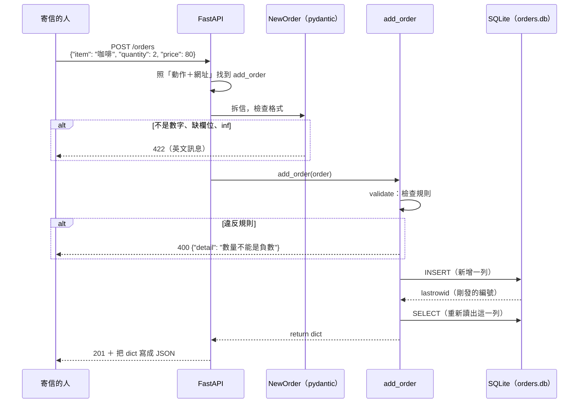
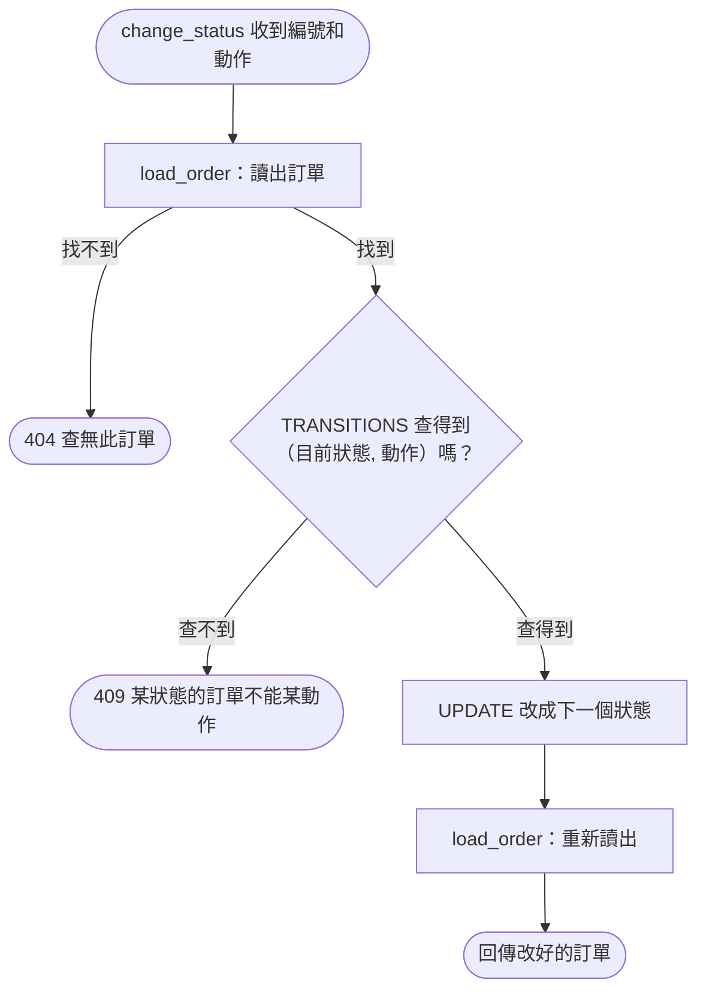
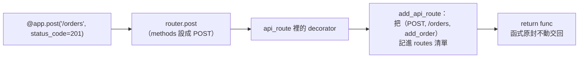
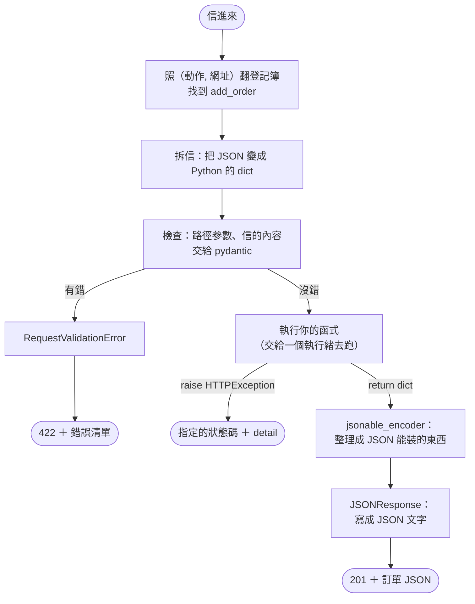

# 複習：訂單 API 網路版的 API 本體（FastAPI ＋ SQLite）

這份逐行解說 [web_api.py](../projects/order_api_web/web_api.py)，也就是 B 階段「收信、處理、回信」的那一邊。目標一樣是**看到程式碼能翻成一句中文**，不用背。

- 第 1 階段的版本在 [order-api-stage1-review.md](order-api-stage1-review.md)。兩個版本一樣的地方（四捨五入、檢查有沒有小數、f-string、`raise`），這裡只放連結，不重講。
- 裝飾器 `@` 的基本規則，在 [pytest-bdd-how-it-works.md](pytest-bdd-how-it-works.md) 的「4. 裝飾器 `@`」。
- 店員網頁（HTML、JavaScript）和測試的幕後（Playwright、conftest.py）另外各寫一份。

寫成事實的地方，都在你電腦上的版本實際跑過或讀過原始碼（FastAPI 0.162.0、starlette 1.10.0、anyio 4.16.0、pydantic 2.14.2、pydantic-core 2.50.2、uvicorn 0.54.0）。原始碼在 `.venv/lib/python3.14/site-packages/` 底下。

---

## 全貌：一封信走過哪些程式碼

以「店員新增一筆咖啡訂單」為例。左邊是寄信的人（網頁、測試、`curl` 都可以），右邊是 `web_api.py` 裡的各個部分：



讀圖重點：**你寫的函式只負責中間那段**。收信、找函式、拆 JSON、檢查格式、把回傳的 dict 寫成 JSON，都是 FastAPI 做的。

## 和第 1 階段對照：什麼變了，什麼沒變

| | 第 1 階段 [order_api.py](../projects/order_api/order_api.py) | B 階段 [web_api.py](../projects/order_api_web/web_api.py) |
|---|---|---|
| 誰呼叫 | 另一支 Python 程式直接呼叫函式 | 透過網路寄信（HTTP） |
| 店員給的資料 | 函式參數 `add_order(orders, item, quantity, price)` | 信裡的 JSON → `NewOrder` |
| 訂單存在哪 | 傳進來的 `orders` list（程式關掉就消失） | SQLite 檔案（程式關掉還在） |
| 編號 | `len(orders) + 1` | 資料庫自動發號 |
| 失敗時 | `raise ValueError("訊息")` | `raise HTTPException(status_code=400, detail="訊息")` |
| 找不到 | `return None` | `404` ＋ `查無此訂單` |
| 計算規則 | `round_half_up`、`calculate_shipping` | **一模一樣** |
| 狀態 | 永遠是待付款 | 有狀態機（付款、取消） |

最後兩列以外，差別都在「**資料從哪裡來、到哪裡去**」，計算的核心沒動。這就是**資料流**換了路線，**API 契約**（計算規則、錯誤訊息）不變。

## 速查表

| 看到這個 | 翻成白話 | 在哪一段 |
|---|---|---|
| `("待付款", "付款")` | 兩個值綁成一組，不能改 | [2](#2-狀態機一張查表用的-dict) |
| `TRANSITIONS.get(key)` | 查表；查不到就給 `None`，不會出錯 | [2](#2-狀態機一張查表用的-dict) |
| `class NewOrder(BaseModel):` | 定義一種「信的格式」 | [3](#3-neworder信要長什麼樣) |
| `item: str` | 這個欄位應該是文字（型別標註） | [3](#3-neworder信要長什麼樣) |
| `order.quantity` | 取出 `order` 的 quantity 欄位 | [4](#4-計算與檢查和第-1-階段幾乎一樣) |
| 函式裡面又 `def` 一個函式 | 小幫手，記得外面的 `db_path` | [5](#5-create_app組裝整個-api) |
| `with connect() as connection:` | 開一段資料庫工作：成功就存檔，出錯就還原 | [5](#5-create_app組裝整個-api) |
| `"SELECT * FROM orders WHERE id = ?"` | SQL：從 orders 表找 id 是某個值的那一列 | [5](#5-create_app組裝整個-api) |
| `@app.post("/orders", status_code=201)` | 「POST /orders 的信交給下面這個函式，成功回 201」 | [6](#6-端點信要交給誰) |
| `def find_order(order_id: int):` | 網址裡的 `{order_id}` 拿來當參數，必須是整數 | [6](#6-端點信要交給誰) |
| `raise HTTPException(404, ...)` | 回一封失敗的信 | [6](#6-端點信要交給誰) |
| `if __name__ == "__main__":` | 「直接執行這個檔案時才做」 | [7](#7-檔案最後啟動伺服器) |

---

## 1. 檔案開頭：說明、借工具、記住自己在哪

```python
"""小店訂單 API（B 階段：網路版）。規格見 SPEC.md。

啟動：uv run python projects/order_api_web/web_api.py，再用瀏覽器打開 http://127.0.0.1:8000
"""

import sqlite3
from pathlib import Path

import uvicorn
from fastapi import FastAPI, HTTPException
from fastapi.responses import HTMLResponse
from pydantic import BaseModel, Field

HERE = Path(__file__).parent
```

開頭的 `"""..."""` 是文件字串，`import` 與 `from ... import` 是「借用別人寫好的工具」，這兩個在 [order-api-stage1-review.md](order-api-stage1-review.md)「補充一」都講過。這裡只看借了哪些工具：

| 程式碼 | 白話 |
|---|---|
| `import sqlite3` | 借 Python 內建的 SQLite 工具，不用另外安裝 |
| `from pathlib import Path` | 借處理「檔案路徑」的工具 |
| `import uvicorn` | 借「讓伺服器開門營業」的工具 |
| `from fastapi import FastAPI, HTTPException` | 借 FastAPI 本體，以及「回失敗的信」的工具 |
| `from fastapi.responses import HTMLResponse` | 借「回信內容是網頁」的標籤 |
| `from pydantic import BaseModel, Field` | 借「定義信件格式」的工具 |
| `HERE = Path(__file__).parent` | 記下「這個檔案所在的資料夾」 |

### `Path(__file__).parent`：這個檔案住在哪

**`__file__`**：Python 自動準備的變數，內容是「目前這個檔案的路徑」。類比：信封上印好的寄件地址，不用自己寫。

`.parent` 是「上一層資料夾」。實際跑出來：

```text
Path(".../order_api_web/web_api.py").parent
→ /Users/shihchieh/python-learning/projects/order_api_web
```

後面會看到 `HERE / "clerk_page.html"`。這裡的 `/` 不是除法：`Path` 把 `/` 當成「接上下一層」，結果是：

```text
/Users/shihchieh/python-learning/projects/order_api_web/clerk_page.html
```

為什麼不直接寫 `"clerk_page.html"`？因為那樣是從「你打指令時所在的資料夾」去找。你在專案根目錄執行，就會找不到。用 `HERE` 開頭，不管從哪裡執行都找得到。

---

## 2. 狀態機：一張查表用的 dict

```python
# 狀態機：(現在的狀態, 動作) → 下一個狀態；表上沒有的組合就是「不能走的路」
TRANSITIONS = {
    ("待付款", "付款"): "已付款",
    ("待付款", "取消"): "已取消",
    ("已付款", "取消"): "已退款",
}
```

| 程式碼 | 白話 |
|---|---|
| `TRANSITIONS = {` | 建一張表，叫 TRANSITIONS（轉換） |
| `("待付款", "付款"): "已付款",` | 待付款的訂單按付款，會變成已付款 |
| `("待付款", "取消"): "已取消",` | 待付款的訂單按取消，會變成已取消 |
| `("已付款", "取消"): "已退款",` | 已付款的訂單按取消，會變成已退款 |

這就是 [SPEC.md](../projects/order_api_web/SPEC.md) 狀態表裡的 3 個 ✅，一列對一列。❌ 的格子**不用寫**：表上找不到，就是不能走。

### 新語法：tuple（元組）

**tuple**：用小括號把幾個值綁成一組，綁好就不能改。類比：裝訂好的兩頁文件，可以整份拿來比對，但不能抽換其中一頁。

你已經會 dict 的 key 用文字，例如 `order["status"]`。這裡的 key 換成一組 `("待付款", "付款")`，意思是「**兩個條件都對上**，才查得到」。

### `.get()`：查不到就給 None

在 `change_status` 裡是這樣查的：

```python
next_status = TRANSITIONS.get((order["status"], action))
```

實際跑出來：

```text
TRANSITIONS.get(("待付款", "付款"))   → 已付款
TRANSITIONS.get(("已取消", "付款"))   → None
TRANSITIONS[("已取消", "付款")]       → KeyError: ('已取消', '付款')
```

| 寫法 | 查不到時 |
|---|---|
| `TRANSITIONS[key]` | 直接出錯（`KeyError`），程式停下來 |
| `TRANSITIONS.get(key)` | 給 `None`，可以接著用 `if ... is None` 處理 |

這裡「查不到」是正常情況（店員按了不能按的按鈕），所以用 `.get()`。

### 和你會的寫法對照：if / elif

同一件事，用 `if` / `elif` 寫是這樣：

```python
def next_status_of(status, action):
    if status == "待付款" and action == "付款":
        return "已付款"
    elif status == "待付款" and action == "取消":
        return "已取消"
    elif status == "已付款" and action == "取消":
        return "已退款"
    return None
```

兩種寫法的結果一樣。查表版的好處是：**規則就是資料**。第 3 階段要加「已付款 → 已出貨」，只要在表裡多一行，不用改任何 `if`。

---

## 3. NewOrder：信要長什麼樣

```python
class NewOrder(BaseModel):
    # 店員寄來的信；不是數字或缺欄位時，FastAPI 會自動回 422
    # 用 float 而不是 int：數量 2.4 要能收進來，才回得出中文的「數量必須是整數」
    # allow_inf_nan=False：無限大和 nan 也算不是數字，在這裡就回 422，進不到計算
    item: str
    quantity: float = Field(allow_inf_nan=False)
    price: float = Field(allow_inf_nan=False)
```

| 程式碼 | 白話 |
|---|---|
| `class NewOrder(BaseModel):` | 定義一種叫 NewOrder 的「信件格式」，用 pydantic 的規則檢查 |
| `item: str` | 要有 item 欄位，而且是文字 |
| `quantity: float = Field(allow_inf_nan=False)` | 要有 quantity 欄位，是數字（可以有小數），但不收無限大和 nan |
| `price: float = Field(allow_inf_nan=False)` | price 同上 |

### 新術語

**class**：定義一種新的「東西」，規定它有哪些欄位。類比：設計一張空白表格的樣式；之後每一封信，都是照這個樣式填好的一張。

**型別標註**（`item: str` 的 `: str`）：寫明這個欄位「應該是什麼種類的值」。`str` 是文字，`float` 是數字（可以有小數），`int` 是整數。類比：表格欄位旁邊的小字「請填數字」。

**pydantic**：FastAPI 用來檢查信件格式的套件。`(BaseModel)` 的意思是「NewOrder 照 pydantic 的規則來檢查」。類比：櫃台的收件員，照表格樣式一格一格核對。

### 和你會的寫法對照：dict

信拆開後，用起來很像 dict，只是取值的寫法不同：

| dict | NewOrder |
|---|---|
| `order["quantity"]` | `order.quantity` |
| 沒規定要有哪些 key | 少一個欄位就回 422 |
| 值是什麼都收 | 值的種類不對就回 422 |

### 幕後：pydantic 實際怎麼檢查

在你電腦上實際跑出來（`→` 右邊是 pydantic 回報的錯誤：哪個欄位、哪種錯）：

```text
NewOrder(item="咖啡", quantity=2, price=80)
→ item='咖啡' quantity=2.0 price=80.0

NewOrder(item="咖啡", quantity="2", price=80)
→ item='咖啡' quantity=2.0 price=80.0

{'item': '咖啡', 'quantity': 'abc', 'price': 80} → [(('quantity',), 'float_parsing')]
{'item': '咖啡', 'quantity': 2}                  → [(('price',), 'missing')]
{'item': '咖啡', 'quantity': 'inf', 'price': 80} → [(('quantity',), 'finite_number')]
```

讀這幾行：

1. 整數 `2` 會被轉成 `2.0`，因為標註是 `float`。
2. 文字 `"2"` 也收：看起來像數字的文字，pydantic 會幫你轉。這就是 `/edges` 時看到「數量 `"2"` 回 201」的原因。
3. `"abc"` 轉不成數字 → `float_parsing`（解析數字失敗）。
4. 少了 price → `missing`（缺欄位）。
5. `"inf"` → `finite_number`（必須是有限的數字），這條是 `allow_inf_nan=False` 擋下來的。

如果拿掉 `allow_inf_nan=False`：

```text
沒有 allow_inf_nan=False： quantity=inf
```

無限大就會被收進來，一路跑到 `int(無限大)` 才出錯，結果就是 `/edges` 抓到的那個 `500`。

### 為什麼標 `float` 而不是 `int`？

如果標 `int`，數量 `2.4` 在拆信時就會被擋下，回英文的 `422`。可是 SPEC 規定數量 2.4 要回**中文**的「數量必須是整數」（`400`）。所以這裡先放寬成 `float`，讓 2.4 進得來，再交給下一段的 `validate` 用中文拒絕。

這是**邊界條件**的分工：格式錯（不是數字）由 pydantic 擋，規則錯（是數字但不合法）由我們自己擋。

---

## 4. 計算與檢查：和第 1 階段幾乎一樣

```python
def round_half_up(number):
    # 一般的四捨五入（.5 一律進位）；Python 內建 round(80.5) 會得到 80，不符合規格
    # 只用在 0 以上的數：負數在呼叫前就已經被擋掉
    return int(number + 0.5)


def calculate_shipping(total):
    if total >= 500:
        return 0
    return 60
```

這兩個函式從第 1 階段原樣搬過來，只拿掉了逐行註解。`int(number + 0.5)` 為什麼能四捨五入，見 [order-api-stage1-review.md](order-api-stage1-review.md)「`int(number + 0.5)`：四捨五入的小技巧」。

```python
def validate(order):
    # 檢查順序照 SPEC「輸入驗證」由上往下，回報第一個遇到的錯誤
    if order.quantity != int(order.quantity):
        return "數量必須是整數"
    if order.quantity < 0:
        return "數量不能是負數"
    if order.quantity > 99:
        return "數量不能超過 99"
    if order.price < 0:
        return "單價不能是負數"
    if order.price > 99999:  # 用原本的值比：99999.4 也算超過
        return "單價不能超過 99999"
    if order.item.strip() == "":
        return "商品名稱不能是空的"
    return None
```

| 程式碼 | 白話 |
|---|---|
| `def validate(order):` | 定義「檢查這封信」的函式，收一封 NewOrder |
| `if order.quantity != int(order.quantity):` | 如果數量去掉小數後不一樣（代表有小數） |
| `return "數量必須是整數"` | 交回錯誤訊息，後面的檢查都不做了 |
| `if order.quantity < 0:` … | 數量是負數 |
| `if order.quantity > 99:` … | 數量超過 99 |
| `if order.price < 0:` … | 單價是負數 |
| `if order.price > 99999:` … | 單價超過 99999；用原本的值比，所以 99999.4 也算 |
| `if order.item.strip() == "":` … | 商品名稱去掉前後空白後是空的 |
| `return None` | 全部通過，沒有錯誤 |

`quantity != int(quantity)` 怎麼抓出小數，見 [order-api-stage1-review.md](order-api-stage1-review.md)「`quantity != int(quantity)`：怎麼抓出『有小數』」。

**和第 1 階段不一樣的地方**：第 1 階段一發現錯誤就 `raise ValueError`；這裡改成 `return` 一句錯誤訊息，由呼叫它的 `add_order` 決定怎麼回信。`validate` 只負責判斷，不用知道 HTTP 的存在。

---

## 5. create_app：組裝整個 API

```python
def create_app(db_path):
    app = FastAPI()
```

| 程式碼 | 白話 |
|---|---|
| `def create_app(db_path):` | 定義「組一個 API 出來」的函式，告訴它資料庫檔案在哪 |
| `app = FastAPI()` | 開一間新的收發室，叫 app |

為什麼要包成函式，而不是直接在檔案裡寫 `app = FastAPI()`？因為**測試和真的店要用不同的資料庫**：測試每個 Scenario 都呼叫 `create_app(暫存檔)`，真的店呼叫 `create_app(orders.db)`。同一份程式，換一個帳本就好。

### 函式裡的函式：記得外面的 `db_path`

`create_app` 裡面又定義了 `connect`、`load_order`、`change_status`，還有後面的各個端點。

**函式裡的函式**：寫在另一個函式裡面的函式，可以直接用外面那個函式的變數。類比：分店的店員，不用每次問就知道「我們分店的帳本放在哪」。

`connect` 裡用到的 `db_path` 沒有從參數傳進來，是直接用 `create_app` 收到的那個。如果寫在外面，每次呼叫都得多傳一個 `db_path`。

### `connect`：打開帳本

```python
    def connect():
        # 每次都重新連線、重新讀出：拿回去的 dict 被改，不會動到資料庫
        connection = sqlite3.connect(db_path)
        connection.row_factory = sqlite3.Row  # 查出來的每一列可以用欄位名稱取值
        return connection
```

| 程式碼 | 白話 |
|---|---|
| `def connect():` | 定義「打開帳本」的小幫手 |
| `connection = sqlite3.connect(db_path)` | 打開 db_path 這個資料庫檔；檔案不存在就新建一個 |
| `connection.row_factory = sqlite3.Row` | 設定：查出來的每一列，可以用欄位名稱取值 |
| `return connection` | 交回這本打開的帳本 |

**連線（connection）**：程式和資料庫之間的一條通道，之後的 SQL 指令都從這條通道送進去。類比：打開帳本、翻到要寫的那頁；要讀、要寫，都得先打開。

`row_factory` 的差別，實際跑出來：

```text
沒設 row_factory： (1, '咖啡')
設了 sqlite3.Row： 咖啡 ；dict(row) = {'id': 1, 'item': '咖啡'}
```

沒設的話，一列只是一組沒有名字的值，要記得「第 2 個是商品名稱」。設了之後可以寫 `row["item"]`，而且 `dict(row)` 能直接變成你熟悉的 dict。API 要回的正是這樣的 dict。

### `load_order`：讀出一筆，找不到就回 404

```python
    def load_order(connection, order_id):
        row = connection.execute("SELECT * FROM orders WHERE id = ?", (order_id,)).fetchone()
        if row is None:
            raise HTTPException(status_code=404, detail="查無此訂單")
        return dict(row)
```

| 程式碼 | 白話 |
|---|---|
| `def load_order(connection, order_id):` | 定義「讀出一筆訂單」的小幫手 |
| `connection.execute("SELECT * FROM orders WHERE id = ?", (order_id,))` | 送一句 SQL：從 orders 表找出 id 等於 order_id 的那一列 |
| `.fetchone()` | 拿回第一列；一列都沒有就是 `None` |
| `if row is None:` | 如果找不到 |
| `raise HTTPException(status_code=404, detail="查無此訂單")` | 回一封「404 查無此訂單」的信，後面都不做了 |
| `return dict(row)` | 找到了，轉成 dict 交回 |

SQL 這一句逐字翻：

| SQL | 白話 |
|---|---|
| `SELECT *` | 我要拿所有欄位（`*` 是「全部」） |
| `FROM orders` | 從 orders 這張表 |
| `WHERE id = ?` | 只要 id 等於某個值的那幾列 |

`?` 是**佔位符**，真正的值放在後面的 `(order_id,)`，第 6 段會講為什麼不直接把值寫進去。`(order_id,)` 是只有一個值的 tuple，**逗號不能省**：少了逗號，`(order_id)` 就只是加了括號的 `order_id`，不是 tuple。

實際跑出來，查不到時 `fetchone()` 確實是 `None`：

```text
查不到： None
```

這和第 1 階段 `find_order` 的「全部比對完都沒有，`return None`」是同一個意思，只是「一筆一筆比對」交給資料庫做了。

### `change_status`：狀態機的本體

```python
    def change_status(order_id, action):
        with connect() as connection:
            order = load_order(connection, order_id)
            next_status = TRANSITIONS.get((order["status"], action))
            if next_status is None:
                raise HTTPException(status_code=409, detail=f"{order['status']}的訂單不能{action}")
            connection.execute("UPDATE orders SET status = ? WHERE id = ?", (next_status, order_id))
            return load_order(connection, order_id)
```

| 程式碼 | 白話 |
|---|---|
| `def change_status(order_id, action):` | 定義「改狀態」的小幫手，收訂單編號和動作（付款或取消） |
| `with connect() as connection:` | 打開帳本，開始一段工作（見下方） |
| `order = load_order(connection, order_id)` | 先讀出這筆訂單；找不到就在這裡回 404 |
| `next_status = TRANSITIONS.get((order["status"], action))` | 用（目前狀態, 動作）查表 |
| `if next_status is None:` | 查不到，代表這條路不能走 |
| `raise HTTPException(status_code=409, detail=f"...")` | 回 409，訊息例如「已取消的訂單不能付款」 |
| `connection.execute("UPDATE orders SET status = ? WHERE id = ?", ...)` | 送 SQL：把這筆的 status 改成下一個狀態 |
| `return load_order(connection, order_id)` | 重新讀出改好的那筆，交回 |

f-string 見 [order-api-stage1-review.md](order-api-stage1-review.md)「f-string：把變數塞進文字」。

`UPDATE` 這句 SQL 逐字翻：

| SQL | 白話 |
|---|---|
| `UPDATE orders` | 修改 orders 表 |
| `SET status = ?` | 把 status 欄改成某個值 |
| `WHERE id = ?` | 只改 id 等於某個值的那一列 |

`WHERE` 很重要：少了它，**整張表的每一筆**都會被改掉。

流程圖，對照 SPEC 的狀態表看：



注意 409 的那條路**根本沒有執行 `UPDATE`**。所以 `.feature` 裡「被拒絕後，再查一次狀態沒變」的那幾個 Scenario 才會通過。

### 新語法：`with`

**`with ... as 名字:`**：開始一段「有頭有尾」的工作，縮排裡的程式跑完，Python 會自動收尾。類比：去銀行辦事，抽號碼牌進去、辦完離開，櫃員會自動結帳；中途出事，就整筆作廢。

`sqlite3` 的連線用在 `with` 裡，收尾的方式是這樣，實際跑出來：

```text
with 結束後連線還能用嗎： ('待付款',)
with 裡出錯後，另開連線讀： ('待付款',)
```

| 情況 | `with` 結束時做什麼 |
|---|---|
| 縮排裡的程式順利跑完 | **存檔**（寫進硬碟） |
| 縮排裡出錯了 | **還原**：這段工作裡改的東西都不算數 |

第二行就是證據：在 `with` 裡先 `UPDATE` 成已付款，接著故意出錯，另開一條連線去讀，還是待付款。

**一個容易誤會的地方**：第一行顯示，`with` 結束後**連線還開著**、還能查。`sqlite3` 的 `with` 只負責「存檔或還原」，不會幫你關掉連線。`web_api.py` 目前也沒有關連線，在這個練習的規模下不影響結果，但這是一個可以改進的地方。

### 建表：`CREATE TABLE`

```python
    # 建立 app 時就建好表；表已經存在（程式重新啟動）就保留原本的資料
    # AUTOINCREMENT：編號只往上加，就算以後有刪除，也不會重複發號
    with connect() as connection:
        connection.execute(
            """
            CREATE TABLE IF NOT EXISTS orders (
                id         INTEGER PRIMARY KEY AUTOINCREMENT,
                item       TEXT    NOT NULL,
                quantity   INTEGER NOT NULL,
                price      INTEGER NOT NULL,
                total      INTEGER NOT NULL,
                shipping   INTEGER NOT NULL,
                amount_due INTEGER NOT NULL,
                status     TEXT    NOT NULL
            )
            """
        )
```

三個引號 `"""` 包起來的文字可以換行，這裡用來把一句很長的 SQL 排整齊。

| SQL | 白話 |
|---|---|
| `CREATE TABLE IF NOT EXISTS orders (` | 建一張叫 orders 的表；**已經有了就不建**，原本的資料保留 |
| `id INTEGER PRIMARY KEY AUTOINCREMENT,` | id 欄：整數，是每一列的身分證號碼，由資料庫自動發號 |
| `item TEXT NOT NULL,` | item 欄：文字，不能空著 |
| `quantity INTEGER NOT NULL,` | quantity 欄：整數，不能空著 |
| `price` … `amount_due` | 同上，都是整數，不能空著 |
| `status TEXT NOT NULL` | status 欄：文字，不能空著 |

對照 [schema.dbml](../projects/order_api_web/schema.dbml)，會發現它們幾乎是一對一：

| schema.dbml | SQL |
|---|---|
| `int` | `INTEGER` |
| `varchar` | `TEXT` |
| `pk` | `PRIMARY KEY` |
| `increment` | `AUTOINCREMENT` |
| `not null` | `NOT NULL` |

你審過的 DBML，在這裡第一次變成一張真的表。

`IF NOT EXISTS` 就是 `persistence.feature`「重新啟動後，訂單還在」的關鍵：每次啟動都會跑這一段，但表已經存在時什麼都不做。

### AUTOINCREMENT：實際試一次

建兩張表，各新增 3 筆、刪掉 3 號、再新增 1 筆，實際跑出來：

```text
INTEGER PRIMARY KEY AUTOINCREMENT：刪掉 3 號後再新增，拿到編號 4
INTEGER PRIMARY KEY：刪掉 3 號後再新增，拿到編號 3
```

沒有 `AUTOINCREMENT` 的話，3 號會被**重新發出去**。客人手上那張寫著「訂單 3」的單子，就會對到別人的訂單。這就是第 1 階段 SPEC 記下的「加入刪除時要改掉編號規則」，這次直接用資料庫解決了。

---

## 6. 端點：信要交給誰

### 幕後：`@app.post(...)` 做了什麼

裝飾器的基本規則（`@機器` 會把下面的函式交給機器處理），見 [pytest-bdd-how-it-works.md](pytest-bdd-how-it-works.md)「4. 裝飾器 `@`」。FastAPI 這台機器做的事是**登記**：



> 原始碼（`fastapi/`）：`applications.py` 第 2791 行，`app.post` 轉給 `self.router.post`；`routing.py` 第 4552 行，`post` 把 `methods=["POST"]` 交給 `api_route`；第 3108～3136 行，`api_route` 裡的 `decorator` 呼叫 `self.add_api_route(path, func, ...)`，最後 `return func`；第 3075 行，`self.routes.append(route)` 記進清單。

所以 `@app.post(...)` **不會改動你的函式**，只是在收發室的登記簿上寫一行：「POST /orders 的信，交給 add_order」。信來的時候，FastAPI 翻登記簿找人。

### 幕後：參數怎麼知道要從哪裡拿

同樣是參數，`order: NewOrder` 從**信裡**拿，`order_id: int` 從**網址**拿。FastAPI 是這樣判斷的：

| 條件 | 從哪裡拿 | 例子 |
|---|---|---|
| 參數名稱出現在網址的 `{...}` 裡 | 網址（路徑參數） | `order_id` 對上 `/orders/{order_id}` |
| 型別是 class（不是單純的數字、文字） | 信裡（JSON） | `order: NewOrder` |
| 其他 | 網址 `?` 後面（這次沒用到） | — |

> 原始碼：`fastapi/utils.py` 第 43～44 行，`get_path_param_names` 用 `re.findall("{(.*?)}", path)` 把網址裡大括號中的名字找出來；`fastapi/dependencies/utils.py` 第 416 行，`is_path_param = param_name in path_param_names`；第 522～534 行依序判斷：是路徑參數 → `Path`，不是單純值 → `Body`（信裡），其他 → `Query`。

**路徑參數**：寫在網址裡的值。類比：查包裹時直接報追蹤號碼，不用另外填表。

### 幕後：回信怎麼產生

| 你的函式做了什麼 | FastAPI 回什麼 | 原始碼（`fastapi/`） |
|---|---|---|
| `return` 一個 dict | 把 dict 寫成 JSON，狀態碼用裝飾器上的 `status_code`（沒寫就是 200） | `routing.py` 第 320 行 `serialize_response`，第 360 行 `jsonable_encoder` |
| `raise HTTPException(status_code=..., detail=...)` | `{"detail": 訊息}` ＋ 指定的狀態碼 | `exception_handlers.py` 第 15～17 行 |
| 拆信時格式不對（pydantic 擋下） | `422` ＋ `{"detail": [錯誤清單]}` | `exception_handlers.py` 第 23～26 行 |

`exception_handlers.py` 的原文：

```python
    return JSONResponse(
        {"detail": exc.detail}, status_code=exc.status_code, headers=headers
    )
```

```python
    return JSONResponse(
        status_code=422,
        content={"detail": jsonable_encoder(exc.errors())},
    )
```

這就解開兩個謎：

- SPEC 的錯誤格式用 `detail`，因為 FastAPI 本來就把 `HTTPException` 的訊息放在 `detail`。
- `422` 的 `detail` 是一個**清單**，不是一句話。網頁把它直接當文字顯示，就出現了 `[object Object]`。

### 店員網頁

```python
    @app.get("/", response_class=HTMLResponse)
    def clerk_page():
        return (HERE / "clerk_page.html").read_text(encoding="utf-8")
```

| 程式碼 | 白話 |
|---|---|
| `@app.get("/", response_class=HTMLResponse)` | 登記：GET / 的信交給下面的函式，回信內容是網頁 |
| `def clerk_page():` | 定義「給店員網頁」的函式 |
| `return (HERE / "clerk_page.html").read_text(encoding="utf-8")` | 讀出網頁檔的全部文字（用 UTF-8 讀中文），交回去 |

沒有 `response_class=HTMLResponse` 的話，FastAPI 會把這串文字當成 JSON 回傳，瀏覽器就會顯示一大串原始碼，而不是網頁。

### 新增訂單

```python
    @app.post("/orders", status_code=201)
    def add_order(order: NewOrder):
        error = validate(order)
        if error is not None:
            raise HTTPException(status_code=400, detail=error)
        quantity = int(order.quantity)
        price = round_half_up(order.price)
        total = price * quantity
        shipping = calculate_shipping(total)
        with connect() as connection:
            cursor = connection.execute(
                "INSERT INTO orders (item, quantity, price, total, shipping, amount_due, status)"
                " VALUES (?, ?, ?, ?, ?, ?, ?)",
                (order.item.strip(), quantity, price, total, shipping, total + shipping, "待付款"),
            )
            return load_order(connection, cursor.lastrowid)  # lastrowid：資料庫剛發的編號
```

| 程式碼 | 白話 |
|---|---|
| `@app.post("/orders", status_code=201)` | 登記：POST /orders 的信交給 add_order，成功時回 201 |
| `def add_order(order: NewOrder):` | 信的內容照 NewOrder 拆好，叫 order |
| `error = validate(order)` | 檢查規則，結果存進 error |
| `if error is not None:` | 如果有錯誤訊息 |
| `raise HTTPException(status_code=400, detail=error)` | 回 400 和那句訊息，後面都不做了 |
| `quantity = int(order.quantity)` | 數量轉成整數（2.0 → 2） |
| `price = round_half_up(order.price)` | 單價四捨五入 |
| `total = price * quantity` | 算小計 |
| `shipping = calculate_shipping(total)` | 算運費 |
| `with connect() as connection:` | 打開帳本，開始一段工作 |
| `cursor = connection.execute("INSERT INTO ...", (...))` | 送 SQL：新增一列，把執行結果存進 cursor |
| `order.item.strip()` | 存之前，先去掉商品名稱前後的空白 |
| `return load_order(connection, cursor.lastrowid)` | 用資料庫剛發的編號，把這一列讀出來交回 |

`INSERT` 這句 SQL 逐字翻：

| SQL | 白話 |
|---|---|
| `INSERT INTO orders` | 在 orders 表新增一列 |
| `(item, quantity, ..., status)` | 要填這幾欄（沒寫 id，讓資料庫自己發） |
| `VALUES (?, ?, ?, ?, ?, ?, ?)` | 值依序是後面那組 tuple 裡的 7 個 |

兩段字串並排會自動接起來，見 [order-api-stage1-review.md](order-api-stage1-review.md)「兩段字串並排會自動接起來」。

**`cursor.lastrowid`**：資料庫剛剛新增那一列的編號。類比：抽號碼機吐出來的那張號碼牌。

為什麼新增完還要 `load_order` 重新讀一次，不直接把手上的值組成 dict 回傳？因為**資料庫裡存的才是真的**。直接讀出來回傳，可以保證「拿回的」和「存進去的」一模一樣。

### 為什麼用 `?`，不用 f-string 把值塞進 SQL

商品名稱裡有單引號時，實際跑出來：

```text
用 ?： [("阿嬤's 蛋糕",)]
用 f-string：OperationalError: near "s": syntax error
```

用 f-string 寫成 `f"... VALUES ('{item}')"`，SQL 會變成 `VALUES ('阿嬤's 蛋糕')`。資料庫讀到 `'阿嬤'` 就以為文字結束了，後面的 `s 蛋糕')` 看不懂。

**佔位符 `?`**：在 SQL 裡先留空格，值另外交給資料庫，由它安全地填進去。類比：制式表格，你只在格子裡寫字；資料庫不會把你寫的字當成指令。如果自己拼字串，就等於讓客人在表格的「指令欄」上亂寫。

這也是**邊界條件**：店員輸入的任何文字（引號、空白、怪符號）都不該弄壞 SQL。

### 查訂單、付款、取消

```python
    @app.get("/orders/{order_id}")
    def find_order(order_id: int):
        with connect() as connection:
            return load_order(connection, order_id)

    @app.post("/orders/{order_id}/pay")
    def pay_order(order_id: int):
        return change_status(order_id, "付款")

    @app.post("/orders/{order_id}/cancel")
    def cancel_order(order_id: int):
        return change_status(order_id, "取消")

    return app
```

| 程式碼 | 白話 |
|---|---|
| `@app.get("/orders/{order_id}")` | 登記：GET /orders/某個編號 的信交給 find_order |
| `def find_order(order_id: int):` | 網址裡的編號叫 order_id，必須是整數，不是就回 422 |
| `return load_order(connection, order_id)` | 讀出來交回；找不到時 load_order 會回 404 |
| `@app.post("/orders/{order_id}/pay")` | 登記：POST /orders/某個編號/pay 交給 pay_order |
| `return change_status(order_id, "付款")` | 交給狀態機，動作是付款 |
| `@app.post("/orders/{order_id}/cancel")` | 登記：POST /orders/某個編號/cancel 交給 cancel_order |
| `return change_status(order_id, "取消")` | 交給狀態機，動作是取消 |
| `return app` | 收發室組好了，交回去 |

付款和取消都只有一行，因為狀態機的規則全在 `TRANSITIONS` 和 `change_status` 裡。這是 **API 契約**的分層：端點只負責「哪個網址對到哪個動作」，規則集中在一個地方。

---

## 7. 檔案最後：啟動伺服器

```python
if __name__ == "__main__":
    uvicorn.run(create_app(HERE / "orders.db"))
```

| 程式碼 | 白話 |
|---|---|
| `if __name__ == "__main__":` | 如果這個檔案是被直接執行的（不是被別人 import） |
| `uvicorn.run(create_app(HERE / "orders.db"))` | 用 orders.db 組一個 API，讓它開門營業 |

**`__name__`**：Python 自動準備的變數，記錄「這個檔案現在是以什麼身分在跑」。類比：同一個人，在自己家是「主人」，到別人家是「客人」。

實際跑出來：

```text
直接執行時：     __name__ = __main__
被 import 時：   __name__ = show_name（檔名）
```

為什麼需要這一行？因為測試會 `from web_api import create_app`。如果沒有這個 `if`，測試一 import，就會用真的 `orders.db` 啟動伺服器，而且卡在那裡不會結束。

`uvicorn.run(...)` 沒寫位址，就用預設值：

> 原始碼：`uvicorn/config.py` 第 199～200 行，`host: str = "127.0.0.1"`、`port: int = 8000`。

所以檔案開頭的說明寫「打開 http://127.0.0.1:8000」。`127.0.0.1` 是「這台電腦自己」，別台電腦連不進來，這也對應 SPEC 的「不做多台電腦同時連線」。

---

## 8. 幕後：FastAPI 收到一封信之後

前面講的是「你寫的程式碼」。這一段往下挖一層，看**工具本身**怎麼做：信進來之後，FastAPI 依序做了哪些事，pydantic 怎麼檢查，回信怎麼變成 JSON，好幾封信同時來時怎麼辦。

### 完整順序



> 原始碼：`fastapi/routing.py` 的 `get_request_handler`（第 397 行起）。第 511 行 `solve_dependencies` 做檢查，第 522 行取出 `errors`；沒有錯時，第 745 行 `run_endpoint_function` 執行你的函式，第 767 行 `serialize_response` 整理回傳值；有錯時，第 791～798 行產生 `RequestValidationError` 並丟出，最後由 `exception_handlers.py` 寫成 422（見第 6 段）。

這張圖說明了一件重要的事：**格式不對的信，你的函式根本不會被呼叫**。所以 `add_order` 裡不用再檢查「quantity 是不是數字」。

### 拆信：pydantic 在裡面怎麼檢查

FastAPI 檢查信的內容時，是把工作交給 pydantic：

> 原始碼：`fastapi/dependencies/utils.py` 第 794～803 行，`_validate_value_with_model_field` 先看欄位有沒有缺（缺了就回 `missing`），再呼叫 `field.validate`；`fastapi/_compat/v2.py` 第 182 行，`self._type_adapter.validate_python(value, ...)`，從這裡進入 pydantic。

你自己寫 `NewOrder(item="咖啡", ...)` 的時候，走的也是同一條路：

> 原始碼：`pydantic/main.py` 第 280 行，`BaseModel` 建立時呼叫 `self.__pydantic_validator__.validate_python(data, self_instance=self)`。

這個 `__pydantic_validator__` 是什麼？實際印出來：

```text
<class 'pydantic_core._pydantic_core.SchemaValidator'>
```

它來自 `pydantic_core` 這個套件。打開 `.venv/lib/python3.14/site-packages/pydantic_core/`，找得到一個檔案：

```text
_pydantic_core.cpython-314-darwin.so
```

`.so` 結尾的檔案不是 Python 程式碼，而是**已經編譯好的機器碼**。pydantic 的檢查核心是用 **Rust** 寫的。

**Rust**：另一種程式語言，寫好後先翻譯成電腦直接看得懂的機器碼，所以跑得比 Python 快很多。類比：Python 像現場口譯，邊讀邊翻；Rust 像事先印好的譯本，拿起來直接讀。

所以 pydantic 分成兩層：

| 層 | 寫在哪 | 做什麼 |
|---|---|---|
| 外層 `pydantic` | Python（`.py`，看得到原始碼） | 讀你寫的 `class NewOrder`，整理成一份「檢查規格」 |
| 核心 `pydantic_core` | Rust（`.so`，看不到原始碼） | 照那份規格，真正一格一格檢查 |

那份「檢查規格」可以印出來看。`NewOrder` 整理出來的是：

```text
item → {'type': 'str'}
quantity → {'type': 'float', 'allow_inf_nan': False}
price → {'type': 'float', 'allow_inf_nan': False}
```

你寫的 `Field(allow_inf_nan=False)`，就是在這裡變成規格裡的一個開關，交給 Rust 那一層去執行。

也可以跳過 `NewOrder(...)`，直接叫核心檢查，結果一樣：

```text
NewOrder.__pydantic_validator__.validate_python({"item": "咖啡", "quantity": "2", "price": 80})
→ item='咖啡' quantity=2.0 price=80.0
```

### 回信：jsonable_encoder 和 JSONResponse

你的函式 `return` 一個 dict 之後，要經過兩步才變成寄出去的 JSON 文字。

**第一步：`jsonable_encoder` 把東西整理成 JSON 裝得下的樣子。**

JSON 只認得幾種東西：文字、數字、`true`/`false`、`null`、清單、物件（像 dict）。Python 的東西比這多，所以要先整理。實際跑出來：

| 交給它 | 整理後 | 原始碼（`fastapi/encoders.py`） |
|---|---|---|
| `{"id": 1, "item": "咖啡", "status": "待付款"}` | `{'id': 1, 'item': '咖啡', 'status': '待付款'}`（不變） | 第 281 行起：dict 的每個值逐一整理 |
| `("待付款", "付款")`（tuple） | `['待付款', '付款']`（變成 list） | 第 318～335 行：tuple、set 都變成 list |
| `Path("/tmp/orders.db")` | `/tmp/orders.db`（變成文字） | 第 275～276 行 |
| `NewOrder(item="咖啡", ...)` | `{'item': '咖啡', 'quantity': 2.0, 'price': 80.0}`（變成 dict） | 第 243 行起 |

文字、數字、`None` 原樣交回（第 277～278 行）。我們的 `load_order` 回傳的是 `dict(row)`，裡面只有文字和整數，所以這一步什麼都不用改。

**第二步：`JSONResponse` 把整理好的東西寫成 JSON 文字。**

> 原始碼：`starlette/responses.py` 第 199～206 行：
>
> ```python
>     def render(self, content: Any) -> bytes:
>         return json.dumps(
>             content,
>             ensure_ascii=False,
>             allow_nan=False,
>             indent=None,
>             separators=(",", ":"),
>         ).encode("utf-8")
> ```

**starlette**：FastAPI 底下的另一個套件，負責 HTTP 比較底層的工作，例如寫回信。類比：FastAPI 是收發室的櫃台，starlette 是後面真正封信、貼郵票的人。

這幾個設定，解開了 `curl` 回信長相的謎。實際跑出來：

```text
json.dumps({"item": "咖啡"})
→ {"item": "咖啡"}

json.dumps({"item": "咖啡"}, ensure_ascii=False, separators=(",", ":"))
→ {"item":"咖啡"}
```

| 設定 | 白話 | 效果 |
|---|---|---|
| `ensure_ascii=False` | 中文照原樣寫 | 不設的話，「咖啡」會變成 `咖啡` |
| `separators=(",", ":")` | 逗號、冒號後面不加空格 | 所以 `curl` 看到的是 `"id":1,"item":...`，擠在一起 |
| `allow_nan=False` | 不准寫出無限大和 nan | 見下方 |

`allow_nan=False` 和你 `/edges` 抓到的洞有關，實際跑出來：

```text
預設：                 {"quantity": Infinity}
allow_nan=False：      ValueError: Out of range float values are not JSON compliant: inf
```

`Infinity` 其實不是正式的 JSON 寫法，所以 starlette 寧可出錯也不寫出來。這也是為什麼我們在**收信**時就用 `allow_inf_nan=False` 把無限大擋掉：讓它一開始就進不來。

### 同時來好幾封信：執行緒

**執行緒**：程式裡可以同時進行的一條工作線。類比：郵局開了好幾個櫃台窗口，好幾位客人可以同時辦事，不用排成一列。

`web_api.py` 的端點都是用一般的 `def` 寫的。FastAPI 遇到一般的 `def`，會把它交給另一個執行緒去跑：

> 原始碼：`fastapi/routing.py` 第 363～376 行，`run_endpoint_function`：如果是 `async def`，直接執行；否則 `run_in_threadpool(...)`，交給執行緒。`starlette/concurrency.py` 第 32～34 行，`run_in_threadpool` 再轉給 `anyio.to_thread.run_sync`。

窗口最多開幾個？

> 原始碼：`anyio/_backends/_asyncio.py` 第 3253～3259 行，`CapacityLimiter(40)`：預設最多 40 個執行緒同時跑。

**anyio**：starlette 用來管理「同時做好幾件事」的套件。類比：郵局的排班表，決定開幾個窗口、誰去哪個窗口。

實際試一次：另外寫一個小 API，每封信故意等 1 秒才回，同時寄 3 封，結果是：

```text
[{'thread': 'AnyIO worker thread', 'id': 6202404864}, {'thread': 'AnyIO worker thread', 'id': 6185578496}, {'thread': 'AnyIO worker thread', 'id': 6219231232}]
3 封信同時寄出，每封要 1 秒，總共花了 1.0 秒
```

三封信由三個不同編號的執行緒處理，總共只花 1 秒，不是 3 秒。

### 這和 `connect()` 有什麼關係？

SQLite 的連線有一條規則，實際跑出來：

```text
別的執行緒用同一條連線：ProgrammingError: SQLite objects created in a thread can only be used in that same thread. ...
```

意思是：**在哪個執行緒打開的帳本，就只能在那個執行緒用**。

`web_api.py` 每處理一封信，就在那封信的執行緒裡重新 `connect()`，所以不會撞到這條規則。如果改成整個程式只開一條連線，讓大家共用，第二封信來的時候就會出現上面這個錯。

| 做法 | 結果 |
|---|---|
| 每封信自己 `connect()`（現在的寫法） | 每個窗口各有一本帳本，不衝突 |
| 全部共用一條連線 | 別的窗口拿去用，就出現 `ProgrammingError` |

不過「好幾封信**同時改同一筆訂單**」會怎樣（例如兩個店員同時按付款），這次沒有測，SPEC 也把多台電腦同時連線列為不做。

---

## 自己動手看：寄一封真的信

先在一個終端機啟動伺服器：

```bash
uv run python projects/order_api_web/web_api.py
```

### 方法一：FastAPI 內建的說明頁

用瀏覽器打開 http://127.0.0.1:8000/docs 。FastAPI 會照你登記的端點，自動產生一頁說明，每個端點都能直接按「Try it out」寄信試試。

> 原始碼：`fastapi/applications.py` 第 444 行，`docs_url` 的預設值是 `"/docs"`。

注意：在這裡寄的信會真的寫進 `orders.db`。

### 方法二：用 `curl` 寄信

**curl**：在終端機寄 HTTP 信的指令。類比：不用網頁，直接手寫信封寄出去。

另開一個終端機，寄一封新增訂單的信（`-i` 是連信封上的代碼一起顯示）：

```bash
curl -i -X POST http://127.0.0.1:8000/orders -H 'Content-Type: application/json' -d '{"item":"咖啡","quantity":2,"price":80}'
```

用暫存資料庫實際跑出來的回信（省略了日期等幾行；你那邊的 `id` 可能不同）：

```text
HTTP/1.1 201 Created
content-type: application/json

{"id":1,"item":"咖啡","quantity":2,"price":80,"total":160,"shipping":60,"amount_due":220,"status":"待付款"}
```

付款兩次（把 `1` 換成你拿到的 id）：

```bash
curl -i -X POST http://127.0.0.1:8000/orders/1/pay
```

```text
HTTP/1.1 200 OK
content-type: application/json

{"id":1,"item":"咖啡","quantity":2,"price":80,"total":160,"shipping":60,"amount_due":220,"status":"已付款"}
```

```text
HTTP/1.1 409 Conflict
content-type: application/json

{"detail":"已付款的訂單不能付款"}
```

網址裡放不是數字的編號：

```bash
curl -i http://127.0.0.1:8000/orders/abc
```

```text
HTTP/1.1 422 Unprocessable Content
content-type: application/json

{"detail":[{"type":"int_parsing","loc":["path","order_id"],"msg":"Input should be a valid integer, unable to parse string as an integer","input":"abc"}]}
```

`"loc":["path","order_id"]` 的意思是「錯在網址（path）的 order_id」，正好對上第 6 段「參數怎麼知道要從哪裡拿」。

看完在第一個終端機按 `Ctrl + C` 關掉伺服器。

---

## 檔案地圖

| 行號 | 段落 | 做什麼 |
|---|---|---|
| 1–14 | [1](#1-檔案開頭說明借工具記住自己在哪) | 說明、借工具、`HERE` |
| 16–21 | [2](#2-狀態機一張查表用的-dict) | 狀態機的表 |
| 24–30 | [3](#3-neworder信要長什麼樣) | 信件格式 |
| 33–59 | [4](#4-計算與檢查和第-1-階段幾乎一樣) | 計算與規則檢查 |
| 62–102 | [5](#5-create_app組裝整個-api) | 打開帳本、讀一筆、改狀態、建表 |
| 104–138 | [6](#6-端點信要交給誰) | 五個端點 |
| 141–142 | [7](#7-檔案最後啟動伺服器) | 啟動伺服器 |
| （工具本身） | [8](#8-幕後fastapi-收到一封信之後) | FastAPI、pydantic、starlette、anyio 在幕後做的事 |

---

## 帶走的三句話

1. **端點只是登記簿**：`@app.post("/orders")` 不會改你的函式，只是寫下「這種信交給誰」。拆信、檢查格式、寫回信都是 FastAPI 做的，你的函式只管中間那段。
2. **狀態機就是一張表**：表上有的組合（✅）可以走，表上沒有的（❌）一律回 409。要加新規則，加一行就好。
3. **資料庫裡的才算數**：新增、改狀態之後都重新讀一次再回傳；值一律用 `?` 交給資料庫，不自己拼進 SQL。

讀不懂一行時，先問三件事：**這行在處理信的哪一段**（拆信、檢查、存檔、回信）？**資料從哪裡來**（網址、信裡、資料庫）？**失敗時回幾號**？
