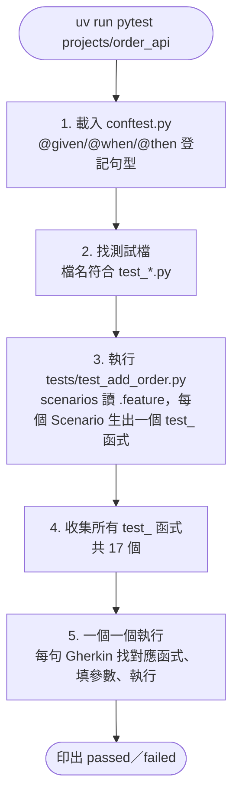
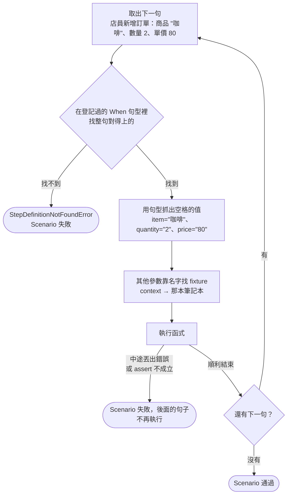

# 幕後：pytest 與 pytest-bdd 是怎麼運作的

[order-api-stage1-review.md](order-api-stage1-review.md) 教你看懂「我們寫的測試程式碼」。這份往下挖一層：**工具本身**怎麼做到的。例如 pytest 怎麼知道要跑哪些檔案、`@given` 貼上去之後到底發生了什麼。

本文內容以你電腦上安裝的版本為準（pytest 9.1.1、pytest-bdd 9.0.0），關鍵處附上原始碼位置，想追的話可以自己打開來看。原始碼在 `.venv/lib/python3.14/site-packages/` 底下。

---

## 全貌：打下 `uv run pytest projects/order_api` 之後



下面一步一步拆。

---

## 1. conftest.py：pytest 會自動載入的「共用設定檔」

`conftest.py` 這個檔名是 pytest 規定的特殊名字。pytest 開始找測試時，會**自動載入**沿路資料夾裡的 `conftest.py`，不需要任何 import。

**conftest.py**：一整個資料夾共用的工具箱。放在 `projects/order_api/` 裡，這個資料夾和底下所有子資料夾（例如 `tests/`）的測試都能使用裡面的東西。

這就是為什麼 `tests/test_add_order.py` 只有兩行，卻能用到 `conftest.py` 裡所有的 step 函式。

### 順帶解開一個謎：conftest.py 為什麼能 `from order_api import ...`？

`order_api.py` 和 `conftest.py` 在同一個資料夾，但我們是從專案根目錄執行 pytest。照理說 Python 不會去 `projects/order_api/` 裡找檔案。

原因是 pytest 預設的匯入方式叫 **prepend**：匯入 `conftest.py` 之前，pytest 會先把它所在的資料夾加到 Python「找檔案的清單」（`sys.path`）**最前面**。所以 conftest.py 一執行 `from order_api import ...`，Python 就能在同一個資料夾找到 `order_api.py`。

> 原始碼：`_pytest/pathlib.py` 的 `import_path`，`ImportMode.prepend` 的說明寫著「the directory containing the module … will be put at the *start* of `sys.path`」，實作在 `sys.path.insert(0, ...)` 那行。

---

## 2. pytest 怎麼找到測試？靠「名字」

pytest 不需要你登記測試，它照**命名規則**自己去找：

| 找什麼 | 預設規則 | 我們的例子 |
|---|---|---|
| 測試檔 | 檔名是 `test_*.py` 或 `*_test.py` | `test_add_order.py` ✅、`conftest.py` ❌、`clerk.py` ❌ |
| 測試函式 | 函式名稱以 `test` 開頭 | `test_未滿_500_元收運費` ✅ |

> 原始碼：`_pytest/python.py` 裡 `python_files` 的預設值 `["test_*.py", "*_test.py"]`，`python_functions` 的預設值 `["test"]`。

所以 `clerk.py` 不會被當成測試執行（不然它的 `main()` 會卡在選單等你打字）。

### 自己看 pytest 找到了什麼

```
uv run pytest projects/order_api --collect-only -q
```

`--collect-only` 是「只找、不跑」，會列出 17 個測試名稱，例如：

```
projects/order_api/tests/test_add_order.py::test_未滿_500_元收運費
projects/order_api/tests/test_add_order.py::test_剛好_500_元免運邊界條件
...
```

---

## 3. 但我們沒寫任何 `test_` 函式啊？`scenarios()` 幫你生的

打開 `tests/test_add_order.py`，只有一行 `scenarios("../features/add_order.feature")`，裡面根本沒有 `def test_...`。那 17 個測試函式是哪來的？

`scenarios()` 做了這些事：

1. 讀 `add_order.feature`，找出所有 Scenario
2. 每個 Scenario 生出一個測試函式
3. 用 Scenario 名稱取名：前面加 `test_`，空白換成底線、標點符號拿掉、英文字母轉小寫（所以「回傳 None」變成 `test_編號不存在回傳_none邊界條件`）
4. **把這些函式直接塞進 `test_add_order.py` 裡**，就像你親手寫了 14 個 `def test_...` 一樣
5. 如果兩個 Scenario 剛好取到同一個名字，後面那個加上 `_1`、`_2` 區分

等 pytest 來找測試時，`test_add_order.py` 裡已經「長出」14 個 `test_` 開頭的函式，第 2 步的命名規則就找得到它們了。

> 原始碼：`pytest_bdd/scenario.py` 的 `scenarios()`。關鍵是 `caller_locals[test_name] = _scenario` 這行：把生出來的函式放進「呼叫 scenarios 的那個檔案」裡。取名規則在同一個檔案的 `get_python_name_generator`：`f"test_{python_name}{suffix}"`；`python_name` 由 `make_python_name` 做出來（換底線、去標點、`.lower()` 轉小寫）。

這也回答了「為什麼是 17 個」：不是誰去數的，是 `scenarios()` 照 `.feature` 裡的 Scenario 數量一個一個生出來的。

---

## 4. 裝飾器 `@`：到底對函式做了什麼

### 先看 Python 本身的規則

這兩種寫法**完全等價**：

```python
@given("目前沒有任何訂單")
def no_orders(context):
    ...
```

```python
def no_orders(context):
    ...
no_orders = given("目前沒有任何訂單")(no_orders)
```

也就是說，`@` 只是一種簡寫：「定義完函式之後，馬上把它交給 `@` 後面那個東西處理一次，再把處理完的結果存回原本的名字」。

讀第二種寫法時拆成兩步：

1. `given("目前沒有任何訂單")`：先用句型做出一個「貼標籤的機器」
2. `(...)(no_orders)`：把函式放進機器

### pytest-bdd 的 `given` 這台機器做了什麼

1. 把句型轉成比對工具（文字句型就照字比對；`parsers.re` 就照正規表示式比對）
2. 把「比對工具＋你的函式」包成一包，**登記成一個 fixture**，名字類似 `pytestbdd_stepdef_given_目前沒有任何訂單`
3. 把你的函式**原封不動**交回去

所以裝飾器的效果是「**登記**」，函式本身沒被改動。就像在公司通訊錄登記「收銀問題找小明」：小明還是小明，只是大家查得到他了。

> 原始碼：`pytest_bdd/steps.py` 的 `step()`（`given`、`when`、`then` 都是呼叫它）。看 `decorator(func)` 裡面：`caller_locals[fixture_step_name] = pytest.fixture(...)` 是登記，最後的 `return func` 是原封不動交回。

---

## 5. fixture：pytest 怎麼把 `context` 遞給你

### 靠「參數名稱」配對

```python
def no_orders(context):
```

pytest 看到參數叫 `context`，就去找**名字也叫 `context` 的 fixture**，執行它、拿到回傳值，再遞進來。你不用自己呼叫 `context()`。

**依賴注入**：需要什麼，在參數上寫名字，系統就自動送來。像在餐廳點餐單上寫「刀叉」，服務生就會送來，你不用自己去廚房拿。

自己看專案裡有哪些 fixture：

```
uv run pytest projects/order_api --fixtures
```

會列出很多 pytest 內建的 fixture，其中一行是我們的：

```
context -- projects/order_api/conftest.py:17
```

### 為什麼每個 Scenario 拿到的 context 都是新的？

fixture 預設的**有效範圍**是「一個測試函式」。每個測試開始時重新執行一次 `context()`，做出新的 dict；測試結束就丟掉。一個 Scenario 就是一個測試函式，所以每個 Scenario 都從空白筆記本開始。

但在**同一個 Scenario 裡**，Given、When、Then 拿到的是**同一本**。所以 When 寫進去的 `result`，Then 讀得到。

---

## 6. 執行一個 Scenario：一句一句配對

以「未滿 500 元，收運費」為例，pytest-bdd 對每一句做同樣的事：



幾個細節：

- **找函式時只看同類型**：When 句只跟 `@when` 登記的句型比對，Given、Then 同理。
- **`And` 跟著上一句的類型**：`Then 拿回的訂單 id 是 3` 後面的 `And 訂單總數變成 3 筆`，會被當成 Then 去找。
- **參數有兩個來源**：句型裡的空格（`item`、`quantity`、`price`），以及 fixture（`context`）。
- **一句失敗，整個 Scenario 就停**：後面的句子不會執行。

> 原始碼：`pytest_bdd/scenario.py` 的 `_execute_scenario`，`for step in scenario.steps:` 一句一句跑，找不到就 `raise StepDefinitionNotFoundError`；比對在 `find_fixturedefs_for_step` 的 `parser.is_matching(step.name)`；fixture 參數在 `_execute_step_function` 裡用 `request.getfixturevalue(arg)` 取得。`And` 的處理在 `pytest_bdd/parser.py`：`STEP_TYPE_BY_PARSER_KEYWORD.get(step.keyword_type, current_type)`，遇到 And 就沿用 `current_type`。

### 如果 `.feature` 有一句打錯字會怎樣？

例如把「目前沒有任何訂單」寫成「目前沒有訂單」。沒有任何 `@given` 的句型對得上，這個 Scenario 會失敗，錯誤訊息是 `StepDefinitionNotFoundError`，還會告訴你是第幾行、哪個 Scenario。

這也是 `/edges` 要檢查「`.feature` 有沒有被動過」的原因之一：句子改一個字，背後的檢查就可能完全不一樣。

---

## 7. 為什麼失敗訊息那麼詳細？pytest 會改寫 assert

你修空白名稱 bug 時看到的是：

```
E       AssertionError: 預期新增失敗（ValueError），但沒有失敗
E       assert None is not None
```

第二行把 `context["error"]` **實際的值**（`None`）也印出來了。一般 Python 的 `assert` 失敗時只會說「失敗了」，不會告訴你左右兩邊的值是什麼。

pytest 會在**載入測試檔之前**，偷偷把裡面的 `assert` 改寫成「失敗時順便印出每個值」的版本。這叫 **assert 改寫**（assertion rewriting）。所以我們只要寫最普通的 `assert a == b`，就能得到詳細的錯誤說明。

> 原始碼：`_pytest/assertion/rewrite.py`。改寫只對 pytest 自己載入的檔案生效，包括測試檔和 `conftest.py`；`order_api.py` 這種被 import 的一般檔案不會被改寫。

---

## 8. `uv run` 又是什麼？

```
uv run pytest projects/order_api
```

`uv run` 的意思是：「用這個專案的 Python 環境（`.venv` 資料夾）來執行後面的指令」。pytest、pytest-bdd 都裝在 `.venv` 裡，不是裝在電腦的全域環境，所以前面要加 `uv run`，才找得到它們。

**虛擬環境（.venv）**：每個專案專屬的工具箱。這個專案裝的套件放在自己的箱子裡，不會和其他專案打架。

---

## 回頭對照：一個 Scenario 從頭到尾

把上面全部串起來，「未滿 500 元，收運費」這個 Scenario 實際經歷了：

1. `uv run` 用 `.venv` 裡的 Python 啟動 pytest
2. pytest 載入 `conftest.py`（先把 `projects/order_api/` 加進 `sys.path`），`@given`、`@when`、`@then` 登記了所有句型，`@pytest.fixture` 登記了 `context`
3. pytest 依命名規則找到 `tests/test_add_order.py` 並載入（同時改寫 assert）
4. 檔案裡的 `scenarios()` 讀 `add_order.feature`，生出 `test_未滿_500_元收運費` 等 14 個函式，塞進這個檔案
5. pytest 收集到這些 `test_` 函式
6. 執行 `test_未滿_500_元收運費`：
   - 做出一本新的 `context`
   - Given「目前沒有任何訂單」→ 找到 `no_orders`，遞入 `context`
   - When「店員新增訂單：…」→ 用 regex 抓出 咖啡、2、80，找到 `clerk_adds_order`，呼叫 `add_order`
   - Then「拿回的訂單是 id 1、…」→ 抓出 8 個值，找到 `order_is`，用 `assert` 比對整筆 dict
7. 三句都沒出錯 → `PASSED`
