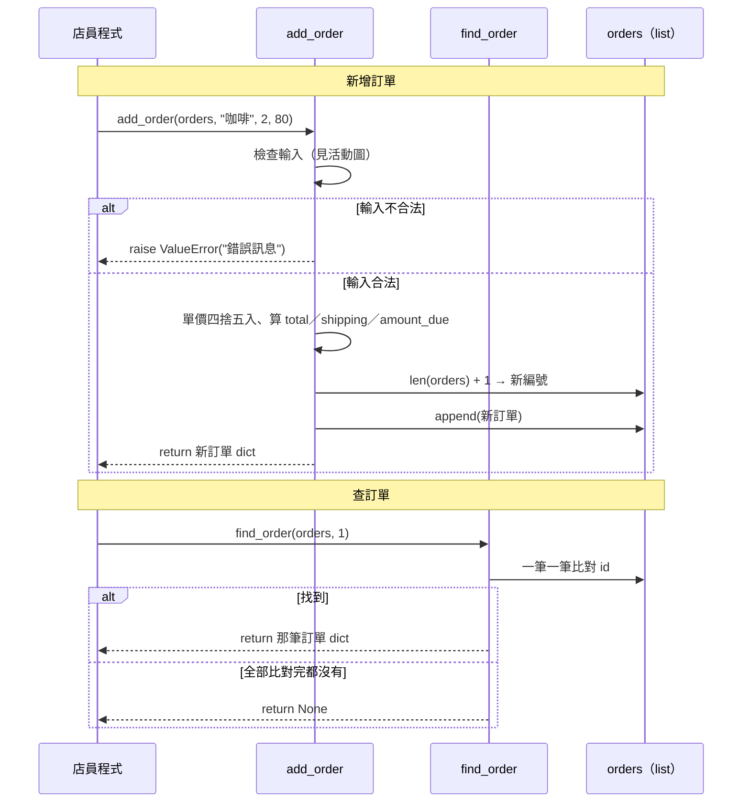
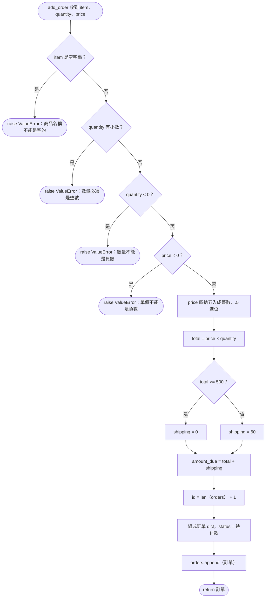

# 小店訂單 API（第 1 階段：本機版）

確認日期：2026-10-31

## 目的

店員不用自己記訂單編號和狀態：新增時 API 自動給號，之後用編號就能查回整筆訂單。

這個專案的學習目的是「自己做 API、自己呼叫」，藉此學會 API 契約。

- **第 1 階段（本份 SPEC）**：API 是 Python 函式，由另一支 Python 程式（扮演店員）呼叫。
- **B 階段（另開 SPEC）**：用 FastAPI 把同一份契約放上 HTTP，再由 AI 撰寫的店員網頁呼叫。

## 功能

| 功能 | 說明 |
|---|---|
| 新增訂單 | 店員給商品、數量、單價，API 自動給號、算金額與運費，回傳整筆訂單 |
| 查訂單 | 店員給訂單編號，API 回傳整筆訂單；找不到回傳 `None` |

## 輸入

| 功能 | 店員給的資料 |
|---|---|
| 新增訂單 | `item`（商品名稱）、`quantity`（數量）、`price`（單價） |
| 查訂單 | `order_id`（訂單編號） |

`id` 與 `status` 由 API 決定，店員不給。

## 輸出

| 功能 | 成功 | 失敗 |
|---|---|---|
| 新增訂單 | 整筆訂單 dict（欄位見 [schema.dbml](schema.dbml)） | 丟出 `ValueError`，附上錯誤訊息；訂單不會被存入 |
| 查訂單 | 整筆訂單 dict，與新增時拿回的相同 | 回傳 `None` |

範例：

```python
{"id": 1, "item": "咖啡", "quantity": 2, "price": 80, "total": 160, "shipping": 60, "amount_due": 220, "status": "待付款"}
```

## 規則

### 編號

- 從 1 開始，每新增一筆加 1（`len(orders) + 1`）。
- 第 1 階段沒有刪除，所以不會撞號；加入刪除功能時要改掉這個規則。

### 金額

- 金額都是整數（元）。
- `price` 有小數時**四捨五入**，.5 一律進位（80.5 → 81）。注意：Python 內建 `round()` 是銀行家捨入（`round(80.5)` 是 80），不符合這條規則。
- `total` = `price` × `quantity`
- `shipping`：`total` 滿 500（含 500）為 0，未滿 500 為 60。`total` 是 0（贈品、數量 0）時同樣收 60。
- `amount_due` = `total` + `shipping`

### 狀態

- 新訂單一律是 `"待付款"`。第 1 階段不做狀態轉換。

### 輸入驗證（失敗時丟出 `ValueError`）

| 情況 | 錯誤訊息 |
|---|---|
| `quantity` 有小數 | `數量必須是整數` |
| `quantity` 是負數 | `數量不能是負數` |
| `price` 是負數 | `單價不能是負數` |
| `item` 是空字串或只有空白 | `商品名稱不能是空的` |

- `quantity` 與 `price` 為 0 是合法的。
- `quantity` 是 `2.0` 這種小數點後為 0 的值，視為整數 2。
- 負數判斷用店員**原本輸入的值**：單價 -0.4 直接失敗，不會先四捨五入成 0。
- 依上表**由上往下**檢查，回報第一個遇到的錯誤（例：數量 -2.4 回「數量必須是整數」）。

## 設計圖

### 循序圖：資料怎麼流過 API



### 活動圖：add_order 內部的步驟



讀圖重點：

- 所有檢查都在**最前面**做完，通過了才開始算、才存入。所以失敗時 orders 不會被動到（對應 Scenario「訂單總數仍然是 0 筆」）。
- 負數檢查（D、F）在四捨五入（G）**之前**，所以單價 -0.4 會失敗。
- 編號（L）在 append（N）**之前**取，所以第一筆是 `len([]) + 1 = 1`。

## 店員程式（clerk.py）

扮演 API 的呼叫者：在終端機顯示選單，店員打字操作，直到選擇離開。

```
=== 小店訂單系統 ===
1. 新增訂單
2. 查訂單
3. 離開
請選擇：1
商品名稱：咖啡
數量：2
單價：80
✅ 新增成功：{'id': 1, 'item': '咖啡', ... 'amount_due': 220, 'status': '待付款'}
```

### 分工

- **店員程式**檢查「是不是數字」：終端機收到的輸入都是文字，要先轉成數字才能交給 API。
- **API** 檢查「數字合不合法」：沿用上方「輸入驗證」，契約不變。

### 輸入處理

| 情況 | 店員程式的回應 |
|---|---|
| 數量或單價不是數字（例：`abc`） | 顯示「請輸入數字」，回到選單 |
| 是數字，但被 API 拒絕（例：-1） | 顯示 API 的錯誤訊息，回到選單 |
| 查訂單時編號不是數字 | 顯示「請輸入數字」，回到選單 |
| 查不到訂單（API 回傳 `None`） | 顯示「查無此訂單」 |
| 選單輸入 1、2、3 以外的東西 | 顯示「請輸入 1、2 或 3」，重新顯示選單 |

### 驗收方式

不寫自動測試；由學習者親手照上表操作一遍。

## 不做的事

| 不做的事 | 什麼時候做 |
|---|---|
| 店員操作網頁（HTML／CSS／JS） | B 階段，由 AI 撰寫 |
| HTTP／FastAPI | B 階段 |
| 修改訂單、刪除訂單 | 之後；加入刪除時，要一併改掉編號規則 |
| 訂單狀態轉換（待付款 → 已付款 → 已出貨） | 第 3 階段，狀態機 |
| 資料永久保存 | 之後。第 1 階段的訂單只存在 list 裡，程式一關就消失 |
| 一張訂單多個商品 | 不在計畫內，一張訂單只有一項商品 |
| 商品價格表（自動帶入單價） | 不在計畫內，單價由店員輸入 |
| 折扣、優惠券 | 不在計畫內 |

## 契約檔

- [schema.dbml](schema.dbml)：訂單的資料結構
- [features/add_order.feature](features/add_order.feature)：新增訂單的驗收條件
- [features/find_order.feature](features/find_order.feature)：查訂單的驗收條件
