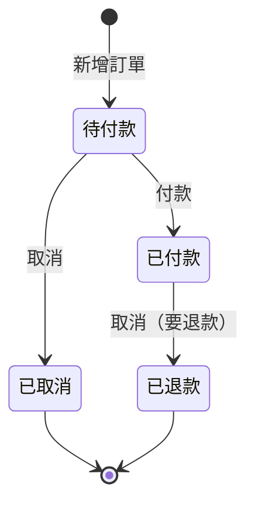

# 小店訂單 API（B 階段：網路版）

確認日期：2026-11-02

## 目的

店員用網頁點選、填表單就能新增、查詢、付款、取消訂單，不用開終端機打字，阿公阿嬤也會用。

這個專案的學習目的：

- 把第 1 階段的 API 契約搬上 HTTP（FastAPI），體驗「API 被另一個程式從網路呼叫」
- 訂單存進資料庫（SQLite），程式重新啟動後還在
- 第一次做狀態機：待付款 → 已付款／已取消，已付款 → 已退款

第 1 階段（[projects/order_api/](../order_api/)）的檔案與測試不動，留著對照。

## 功能

| 功能 | 說明 |
|---|---|
| 新增訂單 | 店員給商品、數量、單價，API 自動給號、算金額與運費，回傳整筆訂單 |
| 查訂單 | 店員給訂單編號，API 回傳整筆訂單 |
| 付款 | 待付款 → 已付款 |
| 取消 | 待付款 → 已取消；已付款 → 已退款 |
| 店員網頁 | 以上四個功能的圖像化操作畫面 |

## 端點

| 功能 | 動作 | 網址 | 店員給的資料 | 成功 | 失敗 |
|---|---|---|---|---|---|
| 新增訂單 | `POST` | `/orders` | 信裡（JSON）：`item`、`quantity`、`price` | `201` ＋ 整筆訂單 | `400` 驗證規則／`422` 不是數字或缺欄位 |
| 查訂單 | `GET` | `/orders/{order_id}` | 網址裡的編號 | `200` ＋ 整筆訂單 | `404`／`422` 編號不是數字 |
| 付款 | `POST` | `/orders/{order_id}/pay` | 網址裡的編號 | `200` ＋ 整筆訂單 | `404`／`409` |
| 取消 | `POST` | `/orders/{order_id}/cancel` | 網址裡的編號 | `200` ＋ 整筆訂單 | `404`／`409` |
| 店員網頁 | `GET` | `/` | 無 | 回傳網頁 | — |

店員網頁與 API 由同一個 FastAPI 程式提供。

### 回信格式

成功：整筆訂單（欄位見 [schema.dbml](schema.dbml)）

```json
{"id": 1, "item": "咖啡", "quantity": 2, "price": 80, "total": 160, "shipping": 60, "amount_due": 220, "status": "待付款"}
```

失敗（`400`、`404`、`409`）：

```json
{"detail": "數量不能是負數"}
```

`422` 由 FastAPI 自動產生，訊息是英文、格式不同；正常操作會先被網頁擋下，所以不另外改寫。

## 規則

### 編號

- 由資料庫自動給號，從 1 開始，每新增一筆加 1。
- 程式重新啟動後接續編號，不會從 1 重來。

### 金額（沿用第 1 階段）

- 金額都是整數（元）。
- `price` 有小數時**四捨五入**，.5 一律進位（80.5 → 81）。Python 內建 `round()` 是銀行家捨入，不符合這條規則。
- `total` = `price` × `quantity`
- `shipping`：`total` 滿 500（含 500）為 0，未滿 500 為 60。`total` 是 0 時同樣收 60。
- `amount_due` = `total` + `shipping`

### 輸入驗證（沿用第 1 階段，失敗回 `400`）

| 情況 | 錯誤訊息 |
|---|---|
| `quantity` 有小數 | `數量必須是整數` |
| `quantity` 是負數 | `數量不能是負數` |
| `quantity` 超過 99 | `數量不能超過 99` |
| `price` 是負數 | `單價不能是負數` |
| `price` 超過 99999 | `單價不能超過 99999` |
| `item` 是空字串或只有空白 | `商品名稱不能是空的` |

- `quantity` 與 `price` 為 0 是合法的；`quantity` 是 `2.0` 視為整數 2。
- 負數與上限判斷都用原本輸入的值：單價 -0.4 直接失敗，單價 99999.4 也失敗。
- 無限大（`inf`）與 `nan` 算「不是數字」，回 `422`。
- 商品名稱存之前，先去掉前後空白（`" 咖啡 "` 存成 `"咖啡"`）。
- 依上表由上往下檢查，回報第一個遇到的錯誤。
- 失敗時資料庫不會多出訂單。

### 誰檢查什麼

| 檢查 | 網頁 | API |
|---|---|---|
| 是不是數字（含沒填、`Infinity`） | ✅ 顯示「請輸入數字」，不送出 | ✅ 回 `422`（防止繞過網頁） |
| 數字合不合法 | — | ✅ 回 `400` |

## 狀態



| 現在的狀態 | 付款 | 取消 |
|---|---|---|
| 待付款 | ✅ → 已付款 | ✅ → 已取消 |
| 已付款 | ❌ | ✅ → 已退款 |
| 已取消 | ❌ | ❌ |
| 已退款 | ❌ | ❌ |

- 都不能回頭；`已取消`、`已退款` 是終點。
- ❌ 回 `409`，錯誤訊息句型：`{目前狀態}的訂單不能{動作}`（例：`已取消的訂單不能付款`）。
- 被拒絕時，訂單狀態不變。
- 付款、退款只改狀態，不處理金額。
- 每次查詢都從資料庫重新讀出，改了拿回來的資料不會動到資料庫（第 1 階段 `/edges` 發現的問題，在這裡自然消失）。

## 永久保存

- 訂單存在專案資料夾裡的 SQLite 資料庫 `orders.db`，會 commit（虛擬情境）。
- 測試每個 Scenario 用全新、空的暫存資料庫，不碰 `orders.db`。
- SQL 由 Claude 撰寫，學習者在底層審，目標是看得懂。

## 店員網頁

- 新增、查詢在同一頁；查到訂單後，旁邊有「付款」「取消」按鈕。
- 錯誤訊息用紅字顯示在畫面上，不跳出彈出視窗。
- 查詢的訂單編號必須是整數；`1.5` 這類也顯示「請輸入數字」。
- 查詢失敗時，收起畫面上原本那筆訂單，避免店員誤認。
- 新增成功後，用一張表顯示整筆訂單，訂單編號特別醒目。
- 欄位名稱用中文：

| 欄位 | 網頁上顯示 |
|---|---|
| `id` | 訂單編號 |
| `item` | 商品 |
| `quantity` | 數量 |
| `price` | 單價 |
| `total` | 小計 |
| `shipping` | 運費 |
| `amount_due` | 應付金額 |
| `status` | 狀態 |

### 驗收方式

- 自動測試：`features/clerk_page.feature`，用程式開真的瀏覽器操作（需安裝 Playwright，安裝前先問學習者）。
- 親手驗收：字體、按鈕夠大，學習者打開網頁看過覺得清楚就算過。

## 不做的事

| 不做的事 | 為什麼／什麼時候做 |
|---|---|
| 老闆功能、權限、登入 | 避免失焦；之後另開階段 |
| 真的金流（輸入金額、刷卡、真的退錢） | 超出這次想學的範圍；付款和退款只改狀態 |
| 出貨、送達 | 這次只做狀態機最小的一段 |
| 逾時自動取消 | 會用到「時間」這個新變數；之後再做 |
| 列出全部訂單 | 沒有這個端點；測試要數訂單時直接查資料庫 |
| 修改訂單內容 | 訂單一建立，只有狀態會變 |
| 刪除訂單 | 取消就是這次的作廢方式，資料留著 |
| 多台電腦同時連線 | 只在自己的電腦上跑 |
| 一張訂單多個商品、商品價格表、庫存、折扣 | 沿用第 1 階段：不在計畫內 |
| 修改第 1 階段的檔案 | B 階段開全新專案，第 1 階段留著對照 |

## 契約檔

- [schema.dbml](schema.dbml)：訂單的資料結構
- [features/add_order.feature](features/add_order.feature)：新增訂單
- [features/find_order.feature](features/find_order.feature)：查訂單
- [features/pay_order.feature](features/pay_order.feature)：付款
- [features/cancel_order.feature](features/cancel_order.feature)：取消
- [features/persistence.feature](features/persistence.feature)：永久保存
- [features/clerk_page.feature](features/clerk_page.feature)：店員網頁
